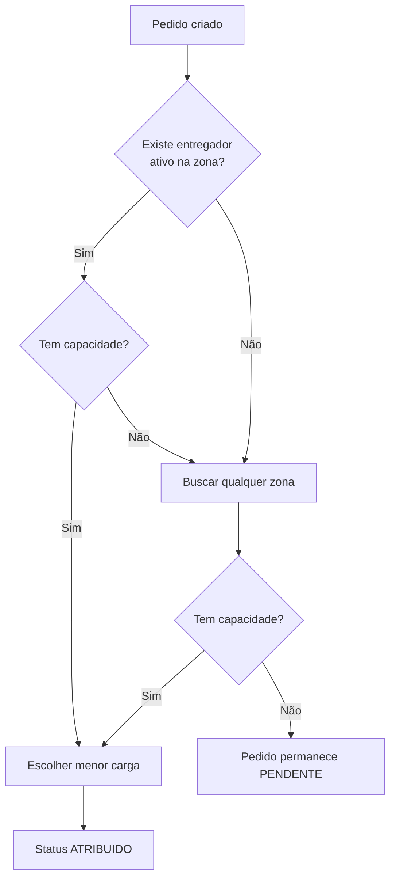

# 02 — Regras de negócio

Este documento descreve as regras implementadas, onde elas vivem no código, como falham e quais
testes as protegem.

## Resumo

| Regra | Tema | Onde é aplicada | Falha |
|---|---|---|---|
| RN01 | Limite de crédito corporativo | `Cliente.permiteCompra`, `PedidoService.verificarCredito` | HTTP 422 |
| RN02 | Caução por vasilhame faltante | `ItemPedido.recalcular`, `PedidoService` | HTTP 200/201 com valor ajustado |
| RN03 | Atribuição automática de entregador | `AtribuicaoEntregadorService`, evento `PedidoCriadoEvent` | Pedido permanece `PENDENTE` |
| RN04 | Cancelamento antes do despacho | `StatusPedido.podeCancelar`, `PedidoService.cancelar` | HTTP 409 |
| RN05 | Validade do vasilhame na troca | `Vasilhame.estaVencido`, `PedidoService.concluirEntrega` | HTTP 200 com recusa + caução |

---

## RN01 — Limite de crédito

### Enunciado

> Clientes corporativos possuem um limite de crédito mensal. Pedidos que excederem o limite
> disponível devem ser bloqueados automaticamente até a regularização financeira.

### Implementação

1. `Cliente` armazena `limiteCredito` e `saldoDevedor`.
2. `Cliente.permiteCompra(valorPedido, valorPedidosEmAberto)` calcula:
   ```text
   saldoDevedor + valorPedidosEmAberto + valorPedido <= limiteCredito
   ```
3. `valorPedidosEmAberto` é a soma dos pedidos nos status `PENDENTE`, `ATRIBUIDO` e `EM_TRANSITO`
   (`PedidoRepository.somarValorPorStatus`). Isso evita que vários pedidos simultâneos estourem o
   limite sem ainda terem virado dívida.
4. A verificação ocorre em `PedidoService.criar`, depois de calcular o total com caução.
5. Se o cliente for residencial, a compra é sempre permitida (não há crédito mensal).
6. Ao concluir uma entrega com forma de pagamento `FATURADO`, o valor final é somado ao
   `saldoDevedor` do cliente.
7. O administrador baixa o saldo com `POST /api/admin/clientes/{id}/pagamentos`.

### Mensagem de erro

```text
RN01: pedido bloqueado por limite de credito. Limite: R$ 2000.00,
saldo devedor: R$ 300.00, pedidos em aberto: R$ 0.00,
total deste pedido: R$ 1850.00.
```

HTTP: **422 Unprocessable Entity**.

### Simulação

`POST /api/pedidos/simulacao` informa:

- `limiteSuficiente`;
- `limiteCredito`;
- `saldoDevedor`;
- `valorPedidosEmAberto`;
- `limiteDisponivel`;
- avisos para a interface.

A tela do cliente desabilita o botão **Confirmar pedido** quando o limite é insuficiente.

### Testes

- `ClienteCreditoTest` — unidade: limite exato, excesso, residencial, limite disponível e pagamento.
- `PedidoServiceIntegrationTest.bloqueiaPedidoAcimaDoLimite` — integração com H2.
- `ClienteService` é coberto indiretamente pelo fluxo E2E de autenticação e perfil.

---

## RN02 — Troca de garrafão vazio por cheio e caução

### Enunciado

> Cada garrafão entregue exige o recebimento de um vasilhame equivalente retornável em bom estado.
> Caso o cliente não possua o vasilhame para troca, uma taxa de caução por garrafão deve ser
> acrescida ao valor do pedido.

### Implementação

1. Cada `Produto` possui `taxaCaucao` (ex.: 20 L = R$ 25,00; 10 L = R$ 20,00; 5 L = R$ 15,00).
2. Cada `ItemPedido` guarda:
   - `quantidade` de garrafões comprados;
   - `vasilhamesDevolvidos` declarados na criação;
   - `taxaCaucaoAplicada` no momento da compra (snapshot histórico);
   - `quantidadeCaucao` e `valorCaucao` calculados.
3. Fórmula:
   ```text
   faltantes = max(0, quantidade - vasilhamesAceitos)
   valorCaucao = faltantes * taxaCaucaoAplicada
   valorTotal = subtotalProdutos + soma(valorCaucao)
   ```
4. Na criação, `vasilhamesAceitos = vasilhamesDevolvidos` declarados.
5. O sistema não aceita declarar mais vasilhames do que o cliente possui **válidos**.
6. Na conclusão, `PedidoService.concluirEntrega` recalcula a caução com base nos vasilhames
   efetivamente aceitos. O total do pedido é atualizado antes da cobrança.
7. O valor da caução é arredondado com `BigDecimal` e escala 2 (`HALF_UP`).

### Exemplo

4 garrafões de 20 L, 2 vasilhames devolvidos:

```text
Produtos  = 4 × R$ 12,00 = R$ 48,00
Caução    = (4 − 2) × R$ 25,00 = R$ 50,00
Total     = R$ 98,00
```

### Testes

- `PedidoCalculoTest` — caução parcial, troca completa, recálculo e total com múltiplos itens.
- `PedidoServiceIntegrationTest.calculaCaucaoEAtribuiEntregadorDaZona`.
- `FluxoPedidoE2ETest` — valida `valorCaucao = 50` e `valorTotal = 98` via HTTP.

---

## RN03 — Atribuição automática de entregador

### Enunciado

> O sistema deve atribuir os pedidos prioritariamente aos entregadores que estejam na mesma zona
> geográfica do endereço de entrega e que possuam capacidade de carga disponível no veículo.

### Implementação

1. Todo cliente possui um endereço com `Zona` (`NORTE`, `SUL`, `LESTE`, `OESTE`, `CENTRO`).
2. O pedido guarda um snapshot do endereço e usa `enderecoEntrega.zona`.
3. Ao criar o pedido, `PedidoService` publica `PedidoCriadoEvent`.
4. `PedidoCriadoListener` chama `AtribuicaoEntregadorService.tentarAtribuir`.
5. O algoritmo:
   - calcula a carga atual do entregador (soma de garrafões de pedidos `ATRIBUIDO` e `EM_TRANSITO`);
   - filtra entregadores ativos da **mesma zona** com `cargaAtual + quantidade <= capacidade`;
   - escolhe o de menor carga (desempate por ID);
   - se nenhum da mesma zona puder, tenta entregadores de outras zonas com capacidade (**fallback**);
   - se ninguém puder, o pedido permanece `PENDENTE` e pode ser atribuído manualmente.
6. A atribuição manual (`POST /api/admin/pedidos/{id}/atribuir`) revalida capacidade e atividade.
7. A capacidade do veículo é considerada na criação e na atribuição manual; o despacho revalida o
   estoque central e a consistência dos vasilhames.

### Diagrama



### Testes

- `AtribuicaoEntregadorTest` — prioridade por zona, fallback, ausência de capacidade, carga atual
  e alteração do status.
- `PedidoServiceIntegrationTest.calculaCaucaoEAtribuiEntregadorDaZona`.
- `FluxoPedidoE2ETest` — verifica Ana Souza (zona SUL) atribuída ao pedido da Maria.

---

## RN04 — Cancelamento de pedido

### Enunciado

> Um pedido só pode ser cancelado pelo cliente caso ainda não tenha sido despachado
> (status anterior a "Em Trânsito").

### Implementação

1. `StatusPedido.podeCancelar()` retorna `true` apenas para `PENDENTE` e `ATRIBUIDO`.
2. `PedidoService.cancelar` valida:
   - existência do pedido;
   - propriedade do pedido (cliente autenticado);
   - `podeCancelar()`.
3. Em caso de conflito, lança `OperacaoNaoPermitidaException` → HTTP **409**.
4. O cancelamento grava `status = CANCELADO`, `canceladoEm` e `motivoCancelamento`.
5. Pedidos cancelados deixam de compor o valor comprometido do limite de crédito.
6. A tela do cliente exibe o botão **Cancelar** somente para `PENDENTE` e `ATRIBUIDO`.

### Testes

- `PedidoCalculoTest.statusPermitemCancelamentoAteAtribuido`.
- `PedidoServiceIntegrationTest.bloqueiaCancelamentoDepoisDoDespacho` — cancela antes e bloqueia
  depois de `EM_TRANSITO`.
- `FluxoPedidoE2ETest` — API retorna 409 após o início do trânsito.

---

## RN05 — Validade do garrafão

### Enunciado

> Cada garrafão possui uma data de validade específica que deve ser rigorosamente verificada no
> momento da troca de vasilhames. Garrafões vencidos não serão aceitos na troca simples e serão
> recusados ou sujeitos à cobrança de taxas adicionais para substituição.

### Implementação

1. `Vasilhame` representa cada garrafão físico, com:
   - `codigo` único;
   - `produto`;
   - `dataValidade`;
   - `status` (`NA_CENTRAL`, `EM_TRANSITO`, `COM_CLIENTE`, `DESCARTADO`);
   - vínculos com cliente, entregador e pedido.
2. A disponibilidade para troca considera apenas vasilhames:
   - em status `COM_CLIENTE`;
   - do produto correspondente;
   - com `dataValidade >= hoje`.
3. Na criação do pedido, o cliente só pode declarar vasilhames válidos que realmente possui.
4. No despacho, o sistema carrega no veículo apenas vasilhames **válidos** do estoque central.
5. Na conclusão:
   - o entregador informa os códigos devolvidos;
   - cada código é validado (pertence ao cliente, está com ele e é do produto do pedido);
   - se `dataValidade < hoje`, o vasilhame é **recusado**, marcado como `DESCARTADO` e não conta
     como devolução;
   - vasilhames válidos retornam ao estoque central (`NA_CENTRAL`);
   - a caução é recalculada com base nos vasilhames válidos aceitos.
6. Os garrafões novos entregues ao cliente são previamente carregados e marcados `COM_CLIENTE`.

### Exemplo

Pedido de 2 garrafões de 20 L, sem devolução declarada:

```text
Total inicial: 2 × 12,00 + 2 × 25,00 = R$ 74,00
Entrega: 1 vasilhame válido + 1 vencido
Aceitos: 1 → caução de 1 × 25,00 = R$ 25,00
Total final: 2 × 12,00 + 25,00 = R$ 49,00
O vasilhame vencido é descartado.
```

### Testes

- `VasilhameValidadeTest` — vencimento, disponibilidade e transições de status.
- `PedidoServiceIntegrationTest.recusaVasilhameVencidoNaTroca` — verifica recusa, caução e estoque.
- `FluxoPedidoE2ETest` — devolução de dois vasilhames válidos.

---

## Regras complementares

Estas regras não estão numeradas no enunciado, mas são necessárias para a integridade da operação.

| Código | Regra | Implementação |
|---|---|---|
| RC01 | Cliente precisa de endereço completo com logradouro, número, bairro, cidade, UF, CEP e zona para pedir | `PedidoService.validarClienteParaPedido` |
| RC02 | Estoque central suficiente na criação | `PedidoService.montarItens` → 409 |
| RC03 | Estoque central suficiente no despacho | `PedidoService.iniciarTransito` → 409 |
| RC04 | Cliente só vê e cancela os próprios pedidos | `PedidoService.buscar/cancelar` |
| RC05 | Entregador só opera pedidos atribuídos a ele | `PedidoService.validarEntregadorDoPedido` |
| RC06 | `FATURADO` é exclusivo de cliente corporativo | `PedidoService.validarFormaPagamento` |
| RC07 | Não repetir o mesmo produto no pedido | `PedidoService.montarItens` |
| RC08 | Não devolver mais vasilhames do que garrafões no item | `PedidoService.montarItens` |
| RC09 | Pagamento não pode exceder o saldo devedor | `ClienteService.registrarPagamento` |
| RC10 | Caução do item usa o preço do momento da compra | `ItemPedido.taxaCaucaoAplicada` |
| RC11 | Somente pedidos `PENDENTES` recebem atribuição manual | `PedidoService.atribuirEntregador` |
| RC12 | Estoque do veículo deve ser consistente na conclusão | `PedidoService.concluirEntrega` |
| RC13 | Reposição de estoque não aceita validade passada | `ProdutoService.reporEstoque` |

## Regras de pagamento

As regras de pagamento complementam a RN01 e são detalhadas nos casos de uso UC05, UC15 e UC16.

| Código | Regra |
|---|---|
| RP01 | Pedido comum criado pelo cliente nasce com pagamento pendente. |
| RP02 | Na conclusão de entrega com forma diferente de `FATURADO`, o pagamento é confirmado e um registro em `Pagamento` é criado, caso ainda não exista. |
| RP03 | `FATURADO` não confirma pagamento: o total é lançado no saldo devedor do cliente. |
| RP04 | O administrador pode criar um pedido em nome do cliente; nesse fluxo a confirmação de pagamento é obrigatória e apenas formas imediatas são aceitas. |
| RP05 | O administrador pode confirmar o pagamento de um pedido existente, exceto cancelado, faturado ou já pago. |
| RP06 | Pedido com pagamento já confirmado não pode ser alterado para `FATURADO` na entrega. |
| RP07 | Cancelamento não estorna automaticamente um pagamento já registrado. |

“Registrar pagamento” na conta do cliente é uma operação distinta: serve apenas para baixar
`saldoDevedor`. O pagamento de um pedido é confirmado pelos fluxos de pedido/entrega.

## Formato de erro

As violações de regra retornam `ProblemDetail` (RFC 9457), por exemplo:

```json
{
  "type": "https://aquadist.local/errors/422",
  "title": "Limite de credito excedido",
  "status": 422,
  "detail": "RN01: pedido bloqueado por limite de credito..."
}
```

Erros de validação incluem o mapa `campos`:

```json
{
  "status": 400,
  "title": "Erro de validacao",
  "detail": "Um ou mais campos estao invalidos.",
  "campos": {
    "itens[0].quantidade": "quantidade deve ser maior que zero"
  }
}
```
