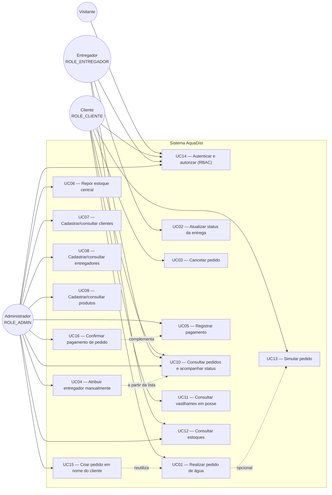
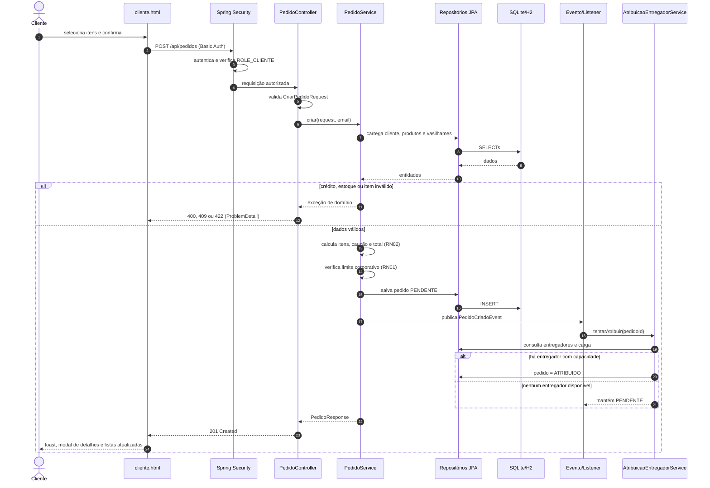

# 03 — Casos de uso

Este documento é o catálogo dos casos de uso implementados na **AquaDist**. Ele descreve o
comportamento observado no código-fonte, os atores envolvidos, os fluxos de sucesso e de falha, os
endpoints utilizados, as classes principais e a cobertura de testes de cada caso de uso.

> **Escopo desta revisão:** somente funcionalidades existentes no repositório. Itens de evolução
> (JWT/OAuth2, gateway de pagamento, aplicativo móvel, roteirização geográfica etc.) não são
> tratados como casos de uso implementados.
>
> **Documentos relacionados:** [02 — Regras de negócio](02-regras-de-negocio.md) para o detalhe das
> RN01–RN05 e das regras complementares; [04 — Arquitetura](04-arquitetura.md) para camadas,
> segurança e máquina de estados; [05 — Modelo de dados](05-modelo-de-dados.md) para entidades e
> ciclo do vasilhame; [06 — API](06-api.md) para contratos e exemplos `curl`; [07 — Testes](07-testes.md)
> para a suíte completa; [08 — Manual de uso](08-manual-de-uso.md) para o roteiro de demonstração.

## 1. Introdução e convenções

### 1.1 Objetivo

O catálogo serve como ponte entre:

- as **regras de negócio** (o que o sistema deve garantir);
- os **fluxos de uso** (quem faz o quê, em que ordem);
- a **API REST** (como a operação é exposta);
- a **implementação** (onde o comportamento vive no código);
- os **testes** (o que está automatizado e o que depende de validação manual).

Cada caso de uso possui uma ficha com identificador, objetivo, atores, pré-condições, gatilho,
pós-condições, regras relacionadas e experiência de usuário. Em seguida são apresentados o fluxo
principal, os fluxos alternativos/de exceção, os endpoints, as classes e os testes.

### 1.2 Atores

| Ator | Perfil / natureza | Descrição | Principais interesses |
|---|---|---|---|
| **Visitante** | não autenticado | Pessoa que acessa as páginas públicas e a tela de login | Entrar no sistema com uma conta válida |
| **Cliente** | `ROLE_CLIENTE` | Pessoa física (residencial) ou empresa (corporativa) que compra água | Simular e criar pedidos, acompanhar entregas, cancelar antes do despacho, consultar vasilhames e limite |
| **Entregador** | `ROLE_ENTREGADOR` | Motorista responsável por uma rota e por um veículo | Consultar a rota, iniciar o trânsito, conferir vasilhames, concluir a entrega e consultar o estoque do veículo |
| **Administrador** | `ROLE_ADMIN` | Operação administrativa da distribuidora | Criar pedidos em nome de clientes, confirmar pagamentos de pedidos, atribuir entregadores, cadastrar clientes/entregadores/produtos, repor estoque e baixar saldo devedor |
| **Sistema** | ator secundário | Cálculos, eventos, persistência e transições automáticas | Aplicar RN01–RN05, atualizar estoque, recalcular caução, confirmar pagamentos e registrar dívida faturada |

O ator **Sistema** não é um usuário: ele representa o comportamento automático do próprio software
(cálculo de caução, verificação de crédito, publicação do evento de atribuição, atualização de
status e de estoque). Em UML, é um ator secundário porque participa dos casos de uso sem iniciar a
interação.

### 1.3 Termos usados

| Termo | Significado |
|---|---|
| **Garrafão** | O produto comercializado (20 L, 10 L ou 5 L), com preço e taxa de caução |
| **Vasilhame** | Cada unidade física retornável, rastreada por código e data de validade |
| **Caução** | Valor cobrado por garrafão entregue sem a devolução de um vasilhame equivalente |
| **Pedido em aberto** | Pedido com status `PENDENTE`, `ATRIBUIDO` ou `EM_TRANSITO`; compromete o limite corporativo |
| **Central** | Estoque físico da distribuidora, representado por vasilhames `NA_CENTRAL` |
| **Veículo** | Estoque em trânsito, representado por vasilhames `EM_TRANSITO` vinculados a um entregador |
| **Rota** | Conjunto de pedidos `ATRIBUIDO` e `EM_TRANSITO` de um entregador |
| **Pagamento do pedido** | Registro de recebimento vinculado a um pedido (`Pagamento.pedido`), com valor e data; independente do status logístico |
| **Baixa de saldo devedor** | Pagamento global do cliente, sem vínculo com um pedido, usado para amortizar o saldo de pedidos `FATURADO` |

### 1.4 Convenções de leitura

- Os casos de uso são numerados como **UC01**, **UC02** etc. Quando um caso possui duas fases
  naturais, elas são indicadas como **UC02.A** e **UC02.B**, sem criar um novo identificador.
- O **fluxo principal** descreve o caminho de sucesso. Variações válidas e falhas estão em
  **fluxos alternativos e de exceção**, com o código HTTP correspondente quando aplicável.
- Os **endpoints** são apresentados com o caminho completo a partir da raiz (`/api/...`). Corpos,
  exemplos e tabelas de campos ficam em [06 — API](06-api.md).
- As **classes principais** são âncoras de implementação, não uma lista exaustiva de todas as
  classes tocadas.
- Os **testes** são classificados como **diretos** (exercitam o caso de uso ou sua regra central) ou
  **indiretos** (usam o comportamento como parte de outro fluxo). Lacunas são explicitadas.
- Os códigos de erro seguem o `ApiExceptionHandler`: `400` para validação/regra de negócio, `401`
  para falta de autenticação, `403` para falta de permissão ou recurso de outro usuário, `404` para
  recurso inexistente, `409` para conflito de estado/estoque e `422` para limite de crédito.
- As regras específicas de pagamento são identificadas como **RP01–RP06** na seção 1.7; elas
  complementam RN01–RN05 e RC01–RC13.
- A expressão **“interface”** refere-se às páginas estáticas em `src/main/resources/static`, que
  usam Tailwind CSS via CDN e JavaScript puro.

### 1.5 Relação com as regras de negócio

As regras detalhadas, mensagens e testes estão em [02 — Regras de negócio](02-regras-de-negocio.md).
Este catálogo apenas indica quais casos de uso as exercitam.

| Regra | Tema | Casos de uso que a exercitam |
|---|---|---|
| **RN01** | Limite de crédito corporativo | UC01 (criação), UC05 (baixa de saldo), UC07 (cadastro com limite), UC13 (simulação), UC15 (pedido assistido) |
| **RN02** | Caução por vasilhame faltante | UC01 (cálculo inicial), UC02 (recálculo na conclusão), UC09 (cadastro de produto), UC11 (disponibilidade), UC13 (simulação), UC15 (pedido assistido) |
| **RN03** | Atribuição de entregador por zona e capacidade | UC01 (atribuição automática), UC04 (atribuição manual), UC08 (cadastro de entregador), UC12 (carga/capacidade), UC15 (pedido assistido) |
| **RN04** | Cancelamento antes do despacho | UC02 (transição de estado), UC03 (cancelamento), UC10 (visibilidade do botão), UC16 (recusa de pedido cancelado) |
| **RN05** | Validade do vasilhame na troca | UC02 (conferência e recusa), UC06 (reposição), UC11 (validade em posse), UC12 (estoque e vencidos), UC15 (devoluções declaradas) |

### 1.6 Regras complementares

As regras complementares **RC01–RC13** estão definidas em
[02 — Regras de negócio](02-regras-de-negocio.md). A tabela abaixo ajuda a localizar onde cada uma
aparece nos casos de uso.

| Código | Resumo | Casos de uso |
|---|---|---|
| **RC01** | Cliente precisa de endereço completo com logradouro, número, bairro, cidade, UF, CEP e zona | UC01, UC07, UC13, UC15 |
| **RC02** | Estoque central suficiente na criação | UC01, UC13 (aviso), UC15 |
| **RC03** | Estoque central suficiente no despacho | UC02 |
| **RC04** | Cliente só vê/cancela os próprios pedidos | UC03, UC10, UC14 |
| **RC05** | Entregador só opera pedidos atribuídos a ele | UC02, UC10, UC14 |
| **RC06** | `FATURADO` é exclusivo de cliente corporativo | UC01, UC02, UC15 (não permitido no fluxo assistido) |
| **RC07** | Não repetir o mesmo produto no pedido | UC01, UC13, UC15 |
| **RC08** | Não devolver mais vasilhames do que garrafões no item | UC01, UC11, UC13, UC15 |
| **RC09** | Pagamento não pode exceder o saldo devedor | UC05 |
| **RC10** | Caução do item usa o preço do momento da compra | UC01, UC09, UC15 |
| **RC11** | Só pedidos `PENDENTES` recebem atribuição manual | UC04 |
| **RC12** | Estoque do veículo deve ser consistente na conclusão | UC02, UC12 |
| **RC13** | Reposição de estoque não aceita validade passada | UC06 |

### 1.7 Regras específicas de pagamento (RP)

Estas regras complementam RN01–RN05/RC01–RC13 e descrevem o comportamento implementado para
pagamentos de pedidos. Elas são referenciadas como **RP** apenas neste catálogo, porque ainda não
estão numeradas em [02 — Regras de negócio](02-regras-de-negocio.md).

| Código | Regra | Onde aparece |
|---|---|---|
| **RP01** | O pedido criado pelo administrador exige `pagamentoConfirmado=true` e uma forma de pagamento imediata: `PIX`, `DINHEIRO`, `CARTAO_CREDITO` ou `CARTAO_DEBITO`. `FATURADO` e `BOLETO` não são aceitos nesse fluxo. | UC15 |
| **RP02** | O pedido criado pelo administrador nasce pago: `pagamentoConfirmado=true`, `pagoEm` preenchido e um `Pagamento` vinculado ao pedido e ao cliente, com o valor total. | UC15 |
| **RP03** | A confirmação de pagamento de pedido existente só é permitida se o pedido não estiver `CANCELADO`, não for `FATURADO` e ainda não tiver pagamento confirmado. A operação marca `pagoEm` e cria um `Pagamento` vinculado. | UC16 |
| **RP04** | Na conclusão da entrega com forma diferente de `FATURADO`, se o pagamento ainda não estiver confirmado, o sistema confirma automaticamente e cria o `Pagamento` com o total final. Se já estiver confirmado, não cria duplicata. | UC02 |
| **RP05** | Pedido `FATURADO` não gera novo `Pagamento`: o total final é lançado no `saldoDevedor` do cliente e a baixa é feita por UC05. Se o pedido já tiver pagamento confirmado, a alteração para `FATURADO` é recusada com `400` e nada é alterado. | UC02, UC05 |
| **RP06** | A confirmação de pagamento não altera o status logístico do pedido (`PENDENTE`, `ATRIBUIDO`, `EM_TRANSITO`, `ENTREGUE` ou `CANCELADO`). | UC15, UC16 |

### 1.8 Estados do pedido

A máquina de estados completa está em [04 — Arquitetura](04-arquitetura.md). Resumo:

```text
PENDENTE -> ATRIBUIDO -> EM_TRANSITO -> ENTREGUE
    |            |
    +------------+------> CANCELADO
```

| Status | Significado | `podeCancelar()` |
|---|---|---|
| `PENDENTE` | Pedido criado, ainda sem entregador | Sim |
| `ATRIBUIDO` | Entregador definido; vasilhames ainda na central | Sim |
| `EM_TRANSITO` | Vasilhames carregados no veículo | Não |
| `ENTREGUE` | Entrega concluída e estoque conciliado | Não |
| `CANCELADO` | Cancelado antes do despacho | Não |

### 1.9 Situação de pagamento do pedido

O pagamento é **ortogonal** ao status logístico. Um pedido pode estar `ENTREGUE` e pago, `ENTREGUE`
e faturado, `PENDENTE` e pago, ou `CANCELADO` e ainda assim manter um pagamento já recebido.

| Situação | Condição no código | Badge em `admin.html` | Ação disponível |
|---|---|---|---|
| **Pago** | `pagamentoConfirmado = true` | `Pago` + data de `pagoEm` | Nenhuma; o botão **Confirmar pagamento** não aparece |
| **Faturado** | `formaPagamento = FATURADO` e pagamento não confirmado (inclusive pedido cancelado) | `Faturado` | Nenhuma; a baixa é feita por UC05 sobre o saldo devedor |
| **Pendente** | Não pago, não `FATURADO` e não `CANCELADO` | `Pendente` | **Confirmar pagamento** (UC16); também pode ser pago automaticamente na conclusão (UC02) |
| **Cancelado sem pagamento** | `status = CANCELADO`, não pago e forma diferente de `FATURADO` | `—` | Nenhuma |
| **Pago e cancelado** | `pagamentoConfirmado = true` e `status = CANCELADO` | `Pago` | Nenhuma; não há estorno automático |

> O badge `Faturado` é derivado da forma de pagamento; `Pago` é derivado do campo
> `pagamentoConfirmado`; `Pendente` cobre as demais formas imediatas e `BOLETO`. O pedido criado
> pelo administrador (UC15) já nasce `Pago`; o pedido comum do cliente (UC01) nasce `Pendente` — ou
> `Faturado`, quando a forma é `FATURADO`.
>
> Um pedido já pago **não pode** ser alterado para `FATURADO` na conclusão: a API retorna `400` e a
> transação é revertida, sem débito nem alteração de pagamento. A tela do entregador também
> desabilita/oculta a opção `FATURADO` quando `pagamentoConfirmado=true`.

## 2. Diagrama de contexto e casos de uso



> **Leitura do diagrama:** UC14 é pré-condição de todos os casos de uso autenticados; para não
> poluir o desenho, as dependências de autenticação não são repetidas em cada ligação. UC15 e UC16
> são os fluxos administrativos de pagamento de pedido; UC05 continua sendo a baixa de saldo
> devedor. O sistema não se integra a gateway de pagamento, serviço de e-mail/SMS, nota fiscal ou
> mapa externo.

## 3. Resumo dos casos de uso

| UC | Nome | Ator principal | Regras principais | Resultado observável |
|---|---|---|---|---|
| **UC01** | Realizar pedido de água | Cliente | RN01, RN02, RN03 | Pedido criado e, se houver capacidade, atribuído |
| **UC02** | Atualizar status da entrega | Entregador | RN02, RN05 | Pedido despachado e/ou entregue com estoque conciliado |
| **UC03** | Cancelar pedido | Cliente | RN04 | Pedido `CANCELADO` antes do despacho |
| **UC04** | Atribuir entregador manualmente | Administrador | RN03 | Pedido `PENDENTE` passa a `ATRIBUIDO` |
| **UC05** | Registrar pagamento de saldo devedor | Administrador | RN01 | Saldo devedor reduzido e histórico gravado |
| **UC06** | Repor estoque central | Administrador | RN05 | Lote de vasilhames `NA_CENTRAL` criado |
| **UC07** | Cadastrar/consultar clientes | Administrador | RN01 | Cliente e usuário criados ou consultados |
| **UC08** | Cadastrar/consultar entregadores | Administrador | RN03 | Entregador e usuário criados ou consultados |
| **UC09** | Cadastrar/consultar produtos | Administrador | RN02 | Produto criado ou catálogo consultado |
| **UC10** | Consultar pedidos e acompanhar status | Cliente, Entregador e Administrador | RN04 | Pedidos visíveis conforme o perfil e a propriedade |
| **UC11** | Consultar vasilhames em posse | Cliente | RN02, RN05 | Vasilhames `COM_CLIENTE` listados com validade |
| **UC12** | Consultar estoque central e do veículo | Administrador e Entregador | RN03, RN05 | Estoques agregados e carga do veículo visíveis |
| **UC13** | Simular pedido | Cliente | RN01, RN02 | Valores, caução e limite calculados sem persistir |
| **UC14** | Autenticar e autorizar acesso (RBAC) | Visitante e perfis autenticados | Segurança/RBAC | Sessão Basic validada e acesso autorizado por perfil |
| **UC15** | Criar pedido em nome do cliente | Administrador | RN01, RN02, RN03; RP01, RP02 | Pedido criado e pago no ato, com `Pagamento` vinculado |
| **UC16** | Confirmar pagamento de pedido | Administrador | RN04; RP03, RP05 | Pedido marcado como pago e `Pagamento` registrado |

## 4. Catálogo detalhado

### UC01 — Realizar pedido de água

| Campo | Descrição |
|---|---|
| **Identificador** | `UC01` |
| **Nome** | Realizar pedido de água |
| **Objetivo** | Registrar um pedido com itens, troca declarada, caução calculada e crédito verificado, disparando a tentativa de atribuição automática de entregador. |
| **Ator principal** | Cliente (`ROLE_CLIENTE`) |
| **Atores secundários** | Sistema (cálculos, crédito, evento); Entregador (recebe o pedido se a atribuição automática encontrar capacidade) |
| **Pré-condições** | Cliente autenticado e ativo; endereço completo com logradouro, número, bairro, cidade, UF, CEP e zona; ao menos um produto ativo; estoque central válido suficiente para cada item. |
| **Gatilho** | Cliente clica em **Confirmar pedido** na tela `cliente.html` (ou envia `POST /api/pedidos`). |
| **Pós-condições** | Pedido persistido como `PENDENTE` ou `ATRIBUIDO`; itens com preço e taxa de caução snapshot; endereço snapshot; caução e totais gravados; evento de atribuição processado na mesma transação; nenhum vasilhame movimentado; `pagamentoConfirmado=false` e nenhum registro em `Pagamento` (o pedido comum não nasce pago). |
| **Regras de negócio** | RN01, RN02, RN03; RC01, RC02, RC06, RC07, RC08, RC10 |
| **Telas e UX** | `cliente.html`: catálogo, carrinho, cálculo, confirmação, modal de detalhes e atualização automática dos pedidos a cada 30 s. |

#### Fluxo principal

1. O cliente autentica-se (UC14) e abre `cliente.html`.
2. A interface carrega, em paralelo, o perfil (`GET /api/clientes/me`), os vasilhames em posse
   (`GET /api/clientes/me/vasilhames`), o catálogo (`GET /api/produtos`) e os pedidos
   (`GET /api/pedidos/me`).
3. O cliente seleciona um produto, informa a quantidade de garrafões e quantos vasilhames
   devolverá na troca.
4. A interface valida localmente: quantidade inteira maior que zero, devoluções não negativas, não
   mais devoluções do que garrafões, não mais devoluções do que vasilhames válidos em posse,
   produto não repetido no carrinho e estoque central maior que zero.
5. O cliente escolhe a forma de pagamento. `FATURADO` fica disponível apenas para cliente
   corporativo.
6. Opcionalmente, o cliente clica em **Calcular valores**, que executa UC13.
7. O cliente clica em **Confirmar pedido**; a interface envia `POST /api/pedidos` com os itens,
   a forma de pagamento e a observação.
8. O controller valida o DTO: ao menos um item, `quantidade >= 1`, `vasilhamesDevolvidos >= 0`,
   forma de pagamento obrigatória e observação de até 500 caracteres.
9. O `PedidoService` carrega o cliente pelo e-mail autenticado e valida: cliente ativo; endereço
   completo com logradouro, número, bairro, cidade, UF, CEP e zona; e `FATURADO` apenas para
   corporativo.
10. Para cada item, o service valida o produto ativo, impede produto repetido, limita as devoluções
    à quantidade do item e aos vasilhames válidos em posse do cliente e confere o estoque central
    válido. Em seguida, cria o `ItemPedido` com preço e taxa de caução snapshot e calcula a caução.
11. O pedido recalcula produtos, caução e total.
12. O service verifica o limite corporativo (RN01): `saldoDevedor + pedidosEmAberto + total` deve
    ser menor ou igual ao `limiteCredito`. Para cliente residencial, a compra é sempre permitida.
13. O pedido é salvo como `PENDENTE` e o `PedidoCriadoEvent` é publicado.
14. O `PedidoCriadoListener` executa de forma síncrona (`@EventListener`) e chama
    `AtribuicaoEntregadorService.tentarAtribuir`. Se houver entregador ativo da mesma zona com
    capacidade — ou, na falta, de outra zona com capacidade (*fallback*) — o pedido passa a
    `ATRIBUIDO`; se ninguém puder atender, permanece `PENDENTE`.
15. A API responde `201 Created` com `PedidoResponse`; o status já pode vir como `ATRIBUIDO` porque
    o listener executa na mesma transação. O pagamento continua pendente
    (`pagamentoConfirmado=false` e `pagoEm` nulo).
16. A interface limpa o carrinho e a observação, exibe um toast, abre o modal de detalhes e recarrega
    perfil, vasilhames, produtos e pedidos.
17. O pagamento pode ser confirmado depois pelo administrador (UC16) ou automaticamente na
    conclusão da entrega, se a forma recebida não for `FATURADO` (UC02).

#### Fluxos alternativos e de exceção

| Situação | HTTP | Comportamento |
|---|---|---|
| DTO inválido (lista vazia, quantidade `< 1`, devoluções negativas, pagamento ausente, observação longa) | `400` | `ProblemDetail` com mapa `campos`; nada é persistido |
| JSON inválido ou enum desconhecido | `400` | `ProblemDetail` “JSON invalido” |
| Sem credenciais | `401` | JSON de “Nao autenticado” |
| Perfil diferente de `CLIENTE` | `403` | Acesso negado pelo `@PreAuthorize` |
| Cliente inativo | `400` | “O cadastro do cliente esta inativo.” |
| Endereço incompleto (logradouro, número, bairro, cidade, UF, CEP ou zona) | `400` | “O cliente precisa ter um endereco completo com zona...” |
| Produto inexistente ou inativo | `404` | “Produto ativo nao encontrado” |
| Produto repetido no pedido | `400` | Regra RC07; nenhum pedido é salvo |
| Devoluções maiores que a quantidade do item | `400` | Regra RC08 |
| Devoluções maiores que os vasilhames válidos em posse | `400` | Informa a quantidade disponível |
| Estoque central insuficiente | `409` | `EstoqueInsuficienteException` com solicitado/disponível |
| `FATURADO` para cliente residencial | `400` | Regra RC06 |
| Limite corporativo excedido | `422` | `CreditoExcedidoException` com a mensagem da RN01 |
| Nenhum entregador com capacidade | `201` | Pedido permanece `PENDENTE`; o admin pode atribuir manualmente (UC04) |
| Falha inesperada na atribuição automática | `201` em geral | O listener registra o erro e mantém o pedido `PENDENTE`; falhas de persistência podem reverter a transação (ver pontos de atenção) |
| Erro inesperado | `500` | `ProblemDetail` genérico, sem detalhes internos |

#### Endpoints utilizados

- `POST /api/pedidos`
- `POST /api/pedidos/simulacao` (opcional, quando o cliente calcula antes de confirmar)
- `GET /api/clientes/me`
- `GET /api/clientes/me/vasilhames`
- `GET /api/produtos`
- `GET /api/pedidos/me`

#### Classes principais

- `PedidoController.criar`
- `PedidoService.criar` → `criarPedido` (método compartilhado com UC15), `montarItens`,
  `verificarCredito`, `validarClienteParaPedido`, `validarFormaPagamento`
- `CriarPedidoRequest`, `ItemPedidoRequest`, `PedidoResponse`, `ItemPedidoResponse`
- `Pedido`, `ItemPedido`, `Cliente`, `Produto`, `Vasilhame`
- `PedidoRepository`, `ClienteRepository`, `ProdutoRepository`, `VasilhameRepository`
- `PedidoCriadoEvent`, `PedidoCriadoListener`, `AtribuicaoEntregadorService.tentarAtribuir`
- `ApiExceptionHandler`

#### Testes que cobrem

| Nível | Teste(s) | Cobertura |
|---|---|---|
| Unitário | `PedidoCalculoTest.calculaCaucaoPorVasilhamesFaltantes`, `semCaucaoQuandoTrocaCompleta`, `somaTotaisDoPedido` | Caução e totais (RN02) |
| Unitário | `ClienteCreditoTest.permiteCompraDentroDoLimite`, `bloqueiaCompraAcimaDoLimite`, `residencialSemprePermite`, `calculaLimiteDisponivel` | Limite corporativo (RN01) |
| Unitário | `AtribuicaoEntregadorTest.priorizaMesmaZona`, `fallbackParaOutraZona`, `semEntregadorDisponivel`, `atribuiPedidoPendente` | Seleção e atribuição automática (RN03) |
| Integração | `PedidoServiceIntegrationTest.calculaCaucaoEAtribuiEntregadorDaZona` | Criação real com H2, caução e atribuição |
| Integração | `PedidoServiceIntegrationTest.bloqueiaPedidoAcimaDoLimite` | Bloqueio por crédito (RN01) |
| E2E | `FluxoPedidoE2ETest.fluxoCompletoDePedido` | `POST /api/pedidos` com `201`, status `ATRIBUIDO`, caução e total |

**Lacunas:** não há teste automatizado dedicado para endereço incompleto, produto repetido,
devoluções acima do disponível, estoque insuficiente na criação, `FATURADO` residencial e falha de
atribuição. Esses caminhos são validados por inspeção do código e pelo roteiro manual de
[08 — Manual de uso](08-manual-de-uso.md).

#### Diagrama de sequência



#### Pontos de atenção

- A resposta pode vir com `ATRIBUIDO` mesmo que o pedido tenha sido persistido inicialmente como
  `PENDENTE`, pois o evento é síncrono e roda na mesma transação.
- O estoque não é reservado na criação: outro pedido pode consumir a central antes do despacho. A
  conferência definitiva ocorre em UC02.
- A declaração de devolução é uma **quantidade**, não a reserva de códigos específicos. Na conclusão,
  o entregador informa os códigos efetivamente recolhidos e a caução é recalculada.
- A interface só desabilita **Confirmar pedido** após uma simulação com limite insuficiente. Sem
  simular, o servidor ainda bloqueia a criação com `422`.
- O listener de atribuição captura `RuntimeException` para não propagar a falha; falhas de
  persistência que marquem a transação como *rollback-only* ainda podem reverter a criação.
- A criação pelo cliente não confirma pagamento. Para o fluxo assistido, com recebimento no ato,
  existe o UC15; para confirmar depois, UC16.
- Um cliente `CLIENTE` não pode chamar `POST /api/admin/pedidos`; o pedido assistido é exclusivo do
  administrador.

---

### UC02 — Atualizar status da entrega

Este caso cobre duas fases do mesmo objetivo: **despachar** o pedido (UC02.A) e **concluir** a
entrega (UC02.B). O ator é o entregador; o sistema movimenta vasilhames e recalcula valores.

| Campo | Descrição |
|---|---|
| **Identificador** | `UC02` (fases UC02.A e UC02.B) |
| **Nome** | Atualizar status da entrega |
| **Objetivo** | Levar o pedido de `ATRIBUIDO` a `EM_TRANSITO` e depois a `ENTREGUE`, carregando vasilhames, conferindo devoluções, recalculando caução/total e confirmando o pagamento quando a forma não for `FATURADO`. |
| **Ator principal** | Entregador (`ROLE_ENTREGADOR`) |
| **Atores secundários** | Cliente (vasilhames em posse), Sistema (estoque, caução, pagamento e dívida), Administrador (acompanha o pedido; não participa da transição) |
| **Pré-condições** | Entregador autenticado e com pedido atribuído a ele; para o despacho, status `ATRIBUIDO`; para a conclusão, status `EM_TRANSITO`; estoque central válido no despacho. |
| **Gatilho** | Entregador clica em **Iniciar trânsito** ou **Concluir entrega** na tela `entregador.html`. |
| **Pós-condições** | Despacho: pedido `EM_TRANSITO`, vasilhames `EM_TRANSITO`, `despachadoEm` preenchido. Conclusão: pedido `ENTREGUE`, vasilhames válidos `NA_CENTRAL`, vencidos `DESCARTADO`, vasilhames carregados `COM_CLIENTE`, caução/total finais gravados e `entregueEm` preenchido. Se a forma final não for `FATURADO` e o pagamento ainda não estiver confirmado, `pagamentoConfirmado=true`, `pagoEm` preenchido e um `Pagamento` vinculado ao pedido é criado. Se for `FATURADO`, o pedido não pode estar pago: com `pagamentoConfirmado=true`, a operação retorna `400` e a transação é revertida; se não estiver pago, o total final é lançado no `saldoDevedor` e nenhum novo `Pagamento` é criado. |
| **Regras de negócio** | RN02, RN05; RN03 (na atribuição que precede o fluxo), RN04 (estado); RC03, RC05, RC06, RC12; RP04, RP05 |
| **Telas e UX** | `entregador.html`: perfil/capacidade, estoque do veículo, cartões de pedido, botão de início, modal de conclusão com conferência, estimativa de caução e resumo final; a opção `FATURADO` é desabilitada/oculta quando o pedido já está pago; polling de 30 s. |

#### Fluxo principal

1. O entregador autentica-se (UC14) e abre `entregador.html`.
2. A interface carrega o perfil (`GET /api/entregador/me`), a rota ativa (`GET /api/entregador/pedidos`)
   e o estoque do veículo (`GET /api/entregador/estoque`).
3. Em um pedido `ATRIBUIDO`, o entregador clica em **Iniciar trânsito**.
4. A interface envia `POST /api/entregador/pedidos/{id}/iniciar-transito`.
5. O service carrega o pedido e o entregador; valida que o pedido existe, que o entregador existe,
   que o pedido está atribuído a ele (`403` caso contrário) e que o status é `ATRIBUIDO` (`409`
   caso contrário).
6. Para cada item, o service busca vasilhames válidos `NA_CENTRAL` do produto, ordenados pela
   validade mais próxima, até a quantidade do item. Se não houver quantidade suficiente, retorna
   `409`.
7. Os vasilhames são marcados como `EM_TRANSITO`, vinculados ao entregador e ao pedido.
8. O pedido passa a `EM_TRANSITO` e recebe `despachadoEm`; a API responde `200 OK`.
9. A interface atualiza a rota, a barra de ocupação e o estoque do veículo.
10. Ao chegar ao cliente, o entregador clica em **Concluir entrega**. A interface consulta
    `GET /api/entregador/pedidos/{id}/vasilhames-cliente`.
11. O `EntregadorService` valida que o pedido está atribuído ao entregador e que está em rota
    (`ATRIBUIDO` ou `EM_TRANSITO`) e retorna os vasilhames `COM_CLIENTE` do cliente, filtrando os
    produtos do pedido e ordenando por volume e validade.
12. A interface exibe os vasilhames com código, produto, validade e indicador de vencido. Os válidos
    são pré-selecionados até o limite de cada item; os vencidos ficam desmarcados e com aviso.
13. O entregador revisa a seleção, informa a forma de pagamento recebida e uma observação opcional.
14. A interface envia `POST /api/entregador/pedidos/{id}/concluir` com
    `codigosVasilhamesDevolvidos`, `formaPagamentoRecebida` e `observacao`.
15. O service valida novamente o pedido, o entregador, a propriedade e o status `EM_TRANSITO`
    (`409` caso contrário).
16. Os códigos são normalizados (`trim` e maiúsculas) e deduplicados. Código em branco, código
    inexistente, vasilhame de outro cliente/fora de posse ou produto fora do pedido geram `400`.
17. Para cada item, o service verifica se as devoluções não excedem a quantidade do item. Vasilhames
    vencidos são marcados `DESCARTADO` e contados como recusados; vasilhames válidos retornam para
    `NA_CENTRAL` e são contados como aceitos. O item recalcula a caução com os válidos aceitos
    (RN02/RN05).
18. O service confere se a quantidade de vasilhames `EM_TRANSITO` daquele pedido/produto é igual à
    quantidade do item; se não for, retorna `409` (RC12). Os vasilhames carregados são entregues ao
    cliente (`COM_CLIENTE`).
19. O pedido recalcula os totais. A forma de pagamento recebida (ou a original, se não informada) é
    validada; `FATURADO` só é aceito para corporativo.
20. Se a forma final for `FATURADO` e o pedido já estiver pago (`pagamentoConfirmado=true`), o
    service lança `RegraDeNegocioException` com a mensagem “Pedido com pagamento confirmado nao pode
    ser alterado para FATURADO na entrega.”; a API retorna `400` e a transação é revertida, sem
    débito ou alteração de pagamento. A interface do entregador desabilita/oculta a opção `FATURADO`
    nesse caso.
21. Se a forma final for `FATURADO` e o pedido não estiver pago, o total final é somado ao
    `saldoDevedor` do cliente e nenhum novo `Pagamento` é criado. Se o saldo ultrapassar o limite, o
    sistema apenas registra um `WARN` no log.
22. Se a forma final não for `FATURADO` e `pagamentoConfirmado` ainda for falso, o sistema chama
    `confirmarPagamentoDoPedido`: marca `pagamentoConfirmado=true`, preenche `pagoEm` e cria um
    `Pagamento` vinculado ao pedido e ao cliente, com o **total final** já recalculado. Se o
    pagamento já estava confirmado (por UC15 ou UC16), nada é duplicado.
23. A observação da entrega é anexada ao pedido, o status vira `ENTREGUE`, `entregueEm` é preenchido
    e a API responde `200 OK`.
24. A interface mostra total final, caução, aceitos e recusados, e atualiza a rota e o estoque.

#### Fluxos alternativos e de exceção

**UC02.A — Iniciar trânsito**

| Situação | HTTP | Comportamento |
|---|---|---|
| Pedido inexistente | `404` | “Pedido nao encontrado” |
| Entregador autenticado sem cadastro de entregador | `404` | “Entregador autenticado nao encontrado” |
| Pedido não atribuído ao entregador | `403` | `AcessoNegadoException` |
| Pedido não está `ATRIBUIDO` | `409` | `OperacaoNaoPermitidaException` com o status atual |
| Estoque central válido insuficiente para um item | `409` | `EstoqueInsuficienteException` com necessário/disponível |
| Sem autenticação / perfil incorreto | `401` / `403` | Segurança HTTP Basic / `@PreAuthorize` |

**UC02.B — Concluir entrega**

| Situação | HTTP | Comportamento |
|---|---|---|
| Pedido não está `EM_TRANSITO` | `409` | `OperacaoNaoPermitidaException` |
| Lista de códigos ausente (`null`) | `400` | Validação `@NotNull`; enviar `[]` quando não houver devolução |
| Código em branco | `400` | “A lista de vasilhames devolvidos contem um codigo vazio.” |
| Código inexistente | `400` | Lista os códigos não encontrados |
| Vasilhame de outro cliente ou que não está `COM_CLIENTE` | `400` | “nao pertence ao cliente deste pedido ou nao esta em posse dele” |
| Vasilhame de produto fora do pedido | `400` | “e de um produto que nao faz parte deste pedido” |
| Mais devoluções do que garrafões no item | `400` | Informa a quantidade do pedido |
| Estoque do veículo inconsistente | `409` | “Inconsistencia no estoque do veiculo...” |
| `FATURADO` para cliente residencial | `400` | Regra RC06 |
| Forma final `FATURADO` em pedido já pago | `400` | “Pedido com pagamento confirmado nao pode ser alterado para FATURADO na entrega.” Nada é alterado; a transação é revertida |
| Forma final `FATURADO` em pedido não pago | `200` | Total final vai para o `saldoDevedor`; nenhum novo `Pagamento` é criado; `pagamentoConfirmado` permanece falso (RP05) |
| Forma final diferente de `FATURADO` e pagamento pendente | `200` | Confirma o pagamento automaticamente e cria um `Pagamento` com o total final (RP04) |
| Pagamento já confirmado antes da entrega | `200` | Não cria segundo `Pagamento`; mantém a confirmação existente |
| Vasilhame vencido | `200` | Não é erro: é marcado `DESCARTADO`, contado como recusado e não entra na troca; a caução é recalculada apenas com os válidos (pode ficar maior que a inicial) |
| Códigos duplicados | `200` | Deduplicados; não geram erro |
| Observação acima de 500 caracteres | `400` | Validação de tamanho |

#### Endpoints utilizados

- `GET /api/entregador/me`
- `GET /api/entregador/pedidos`
- `GET /api/entregador/pedidos/{id}`
- `GET /api/entregador/pedidos/{id}/vasilhames-cliente`
- `GET /api/entregador/estoque`
- `POST /api/entregador/pedidos/{id}/iniciar-transito`
- `POST /api/entregador/pedidos/{id}/concluir`

#### Classes principais

- `EntregadorController.iniciarTransito`, `concluir`, `vasilhamesCliente`
- `PedidoService.iniciarTransito`, `concluirEntrega`, `confirmarPagamentoDoPedido`,
  `validarEntregadorDoPedido`
- `EntregadorService.vasilhamesClienteDoPedido`
- `EstoqueService.vasilhamesDoClienteParaPedido`, `estoqueEntregador`
- `ConcluirEntregaRequest`, `PedidoResponse`, `ItemPedidoResponse`, `VasilhameResponse`
- `Pedido`, `ItemPedido`, `Vasilhame`, `Cliente`, `Entregador`, `Pagamento`
- `Vasilhame.carregarParaTransito`, `entregarAoCliente`, `retornarACentral`, `descartar`
- `PedidoRepository`, `VasilhameRepository`, `EntregadorRepository`, `PagamentoRepository`
- `ApiExceptionHandler`

#### Testes que cobrem

| Nível | Teste(s) | Cobertura |
|---|---|---|
| Unitário | `VasilhameValidadeTest.identificaVencido`, `disponibilidadeParaTroca`, `transicoesDeStatus` | Validade e transições do vasilhame (RN05) |
| Unitário | `PedidoCalculoTest.recalculaAposConferencia` | Recálculo da caução após a conferência (RN02) |
| Integração | `PedidoServiceIntegrationTest.recusaVasilhameVencidoNaTroca` | Despacho, conclusão, recusa de vencido, caução, estoque e pagamento automático no caminho (sem asserção específica do `Pagamento`) |
| E2E | `FluxoPedidoE2ETest.fluxoCompletoDePedido` | Início de trânsito, bloqueio de cancelamento e conclusão com dois válidos; o pagamento é confirmado pelo fluxo, mas o teste não o verifica |

**Lacunas:** não há teste automatizado dedicado para pedido não atribuído ao entregador, status
incorreto, código inexistente, vasilhame de outro cliente/produto, devoluções acima do item,
inconsistência do estoque do veículo, duplicidade de pagamento, alteração para `FATURADO` em pedido
já pago ou diferença entre o valor pago e o total recalculado. A integração cobre o caminho de
sucesso com um vasilhame vencido.

#### Diagrama de sequência

```mermaid
sequenceDiagram
    autonumber
    actor E as Entregador
    participant UI as entregador.html
    participant EC as EntregadorController
    participant PS as PedidoService
    participant ES as EntregadorService
    participant REP as Repositórios JPA
    participant DB as SQLite/H2

    E->>UI: Iniciar trânsito
    UI->>EC: POST /api/entregador/pedidos/{id}/iniciar-transito
    EC->>PS: iniciarTransito(id, email)
    PS->>REP: carrega pedido e entregador
    REP->>DB: SELECTs
    PS->>PS: valida propriedade e status ATRIBUIDO
    alt estoque central insuficiente
        PS-->>EC: EstoqueInsuficienteException
        EC-->>UI: 409 ProblemDetail
    else estoque disponível
        PS->>REP: vasilhames NA_CENTRAL → EM_TRANSITO
        PS->>REP: pedido → EM_TRANSITO + despachadoEm
        PS-->>EC: PedidoResponse
        EC-->>UI: 200 OK
        UI-->>E: rota e estoque atualizados
    end

    E->>UI: Concluir entrega
    UI->>EC: GET /api/entregador/pedidos/{id}/vasilhames-cliente
    EC->>ES: vasilhamesClienteDoPedido(id, email)
    ES->>REP: consulta vasilhames COM_CLIENTE do cliente
    REP->>DB: SELECT
    ES-->>EC: lista de vasilhames
    EC-->>UI: 200 OK
    UI-->>E: códigos, validade e indicação de vencido
    opt pedido já pago
        UI-->>E: opção FATURADO desabilitada/oculta
    end

    E->>UI: confirma devoluções e pagamento
    UI->>EC: POST /api/entregador/pedidos/{id}/concluir
    EC->>PS: concluirEntrega(id, email, request)
    PS->>REP: valida pedido, entregador, códigos e produtos
    loop cada item do pedido
        alt vasilhame vencido
            PS->>REP: vasilhame → DESCARTADO (recusado)
        else vasilhame válido
            PS->>REP: vasilhame → NA_CENTRAL (aceito)
        end
        PS->>PS: recalcula caução do item (RN02/RN05)
        PS->>REP: vasilhames EM_TRANSITO → COM_CLIENTE
    end
    PS->>PS: recalcula total
    alt forma final FATURADO
        alt pagamento já confirmado
            PS-->>EC: RegraDeNegocioException
            EC-->>UI: 400; transação revertida
        else pagamento pendente
            PS->>PS: lança total no saldo devedor; sem Pagamento
        end
    else forma imediata e pagamento pendente
        PS->>PS: confirma pagamento e cria Pagamento com total final
    else pagamento já confirmado
        PS->>PS: mantém pagamento existente, sem duplicar
    end
    PS->>REP: pedido → ENTREGUE + entregueEm
    PS-->>EC: PedidoResponse
    EC-->>UI: 200 OK com resumo
    UI-->>E: total, caução, aceitos e recusados
```

#### Pontos de atenção

- **Capacidade no despacho:** o código atual valida a capacidade na atribuição automática e na
  manual, mas **não revalida** a capacidade em `iniciarTransito`. O despacho verifica propriedade,
  status e estoque central. Veja a seção de inconsistências.
- **Validade dos garrafões entregues:** a seleção no despacho considera apenas vasilhames válidos,
  mas não há revalidação da validade entre o despacho e a conclusão.
- **Devolução por pool do cliente:** o código valida que o vasilhame pertence ao cliente e é do
  produto do pedido, mas não exige que ele tenha sido originalmente entregue por esse pedido.
- **Vencido não é erro:** a conclusão com vasilhame vencido retorna `200`, marca o vasilhame como
  `DESCARTADO` e cobra a caução correspondente.
- **FATURADO:** se o valor final ultrapassar o limite corporativo, o sistema registra um `WARN` e
  conclui a entrega; não bloqueia a operação nesse momento.
- **Pagamento recebido:** se a forma final não for `FATURADO` e o pagamento estiver pendente, a
  conclusão confirma o pagamento e cria um `Pagamento` vinculado ao pedido, com o total final. Se o
  pedido já estava pago (por UC15/UC16), não há duplicata. Para `FATURADO` em pedido não pago,
  nenhum novo `Pagamento` é criado; o valor vai para o saldo devedor e a baixa é feita por UC05.
  Para `FATURADO` em pedido já pago, a operação é recusada com `400`.
- **Caução x valor pago:** um pedido pago antes da entrega (UC15/UC16) pode ter o total final
  recalculado na conclusão; o `Pagamento` já criado não é ajustado automaticamente.
- **FATURADO após pagamento:** bloqueado. Se o pedido já está pago, o backend retorna `400` com a
  mensagem “Pedido com pagamento confirmado nao pode ser alterado para FATURADO na entrega.” e
  reverte a transação. A tela do entregador desabilita/oculta `FATURADO` quando
  `pedido.pagamentoConfirmado` é verdadeiro.
- **Flag `Entregador.ativo`:** é validada na atribuição automática e na manual, mas não é
  revalidada em `iniciarTransito`/`concluirEntrega`; não há endpoint de desativação nesta versão.

---

### UC03 — Cancelar pedido

| Campo | Descrição |
|---|---|
| **Identificador** | `UC03` |
| **Nome** | Cancelar pedido |
| **Objetivo** | Permitir que o cliente cancele o próprio pedido antes do despacho, registrando data e motivo. |
| **Ator principal** | Cliente (`ROLE_CLIENTE`) |
| **Atores secundários** | Sistema (validação de estado); Entregador (tem a rota liberada se o pedido estava atribuído) |
| **Pré-condições** | Cliente autenticado; pedido do próprio cliente; status `PENDENTE` ou `ATRIBUIDO`. |
| **Gatilho** | Cliente clica em **Cancelar** e confirma no modal. |
| **Pós-condições** | Pedido `CANCELADO`, com `canceladoEm` e `motivoCancelamento`; nenhum vasilhame é movimentado; o pedido deixa de compor o valor em aberto do limite. Se o pedido já estava pago, o `Pagamento` e a flag `pagamentoConfirmado` permanecem, sem estorno automático. |
| **Regras de negócio** | RN04; RC04 |
| **Telas e UX** | `cliente.html`: botão **Cancelar** apenas em `PENDENTE`/`ATRIBUIDO`; modal com resumo, motivo opcional, confirmação explícita e erro inline. |

#### Fluxo principal

1. O cliente abre **Meus pedidos**; a interface exibe **Cancelar** somente para pedidos
   `PENDENTE` ou `ATRIBUIDO`.
2. O cliente clica em **Cancelar**; a interface abre um modal com cliente, quantidade, forma de
   pagamento, entregador, status e total, além do aviso de irreversibilidade.
3. O cliente informa um motivo opcional e confirma.
4. A interface envia `POST /api/pedidos/{id}/cancelar` com `{ "motivo": "..." }` (o corpo é
   opcional).
5. O service carrega o pedido; se não existir, retorna `404`; se não pertencer ao cliente
   autenticado, retorna `403`.
6. O service verifica `StatusPedido.podeCancelar()`. Se o pedido já estiver `EM_TRANSITO`,
   `ENTREGUE` ou `CANCELADO`, retorna `409` com a mensagem da RN04.
7. O pedido recebe `CANCELADO`, `canceladoEm = now` e o motivo informado (ou
   `"Cancelado pelo cliente"` quando vazio).
8. A API responde `200 OK`; a interface fecha o modal, exibe toast e recarrega perfil e pedidos. O
   botão **Cancelar** desaparece.

#### Fluxos alternativos e de exceção

| Situação | HTTP | Comportamento |
|---|---|---|
| Pedido inexistente | `404` | “Pedido nao encontrado” |
| Pedido de outro cliente | `403` | “Este pedido nao pertence ao cliente autenticado.” |
| Pedido `EM_TRANSITO`, `ENTREGUE` ou `CANCELADO` | `409` | “RN04: o pedido nao pode mais ser cancelado...” |
| Corpo ausente ou motivo em branco | `200` | Motivo padrão “Cancelado pelo cliente” |
| Motivo acima de 500 caracteres | `400` | Validação de tamanho |
| Sem autenticação / perfil incorreto | `401` / `403` | Segurança HTTP Basic / `@PreAuthorize` |

#### Endpoints utilizados

- `POST /api/pedidos/{id}/cancelar`
- `GET /api/pedidos/me`
- `GET /api/clientes/me` (recarregar o limite após o cancelamento)

#### Classes principais

- `PedidoController.cancelar`
- `PedidoService.cancelar`
- `StatusPedido.podeCancelar`
- `CancelarPedidoRequest`
- `PedidoRepository`, `PedidoResponse`
- `ApiExceptionHandler`

#### Testes que cobrem

| Nível | Teste(s) | Cobertura |
|---|---|---|
| Unitário | `PedidoCalculoTest.statusPermitemCancelamentoAteAtribuido` | `PENDENTE`/`ATRIBUIDO` permitem; os demais não (RN04) |
| Integração | `PedidoServiceIntegrationTest.bloqueiaCancelamentoDepoisDoDespacho` | Cancela antes e bloqueia depois de `EM_TRANSITO` |
| E2E | `FluxoPedidoE2ETest.fluxoCompletoDePedido` | `409` após o início do trânsito |

**Lacunas:** não há teste dedicado para pedido de outro cliente, motivo padrão ou motivo acima de
500 caracteres.

#### Pontos de atenção

- Não existe cancelamento pelo administrador nem pelo entregador; o endpoint é exclusivo do cliente
  dono do pedido.
- O cancelamento não estorna caução, pois a caução só é efetivamente movimentada na entrega; não há
  movimentação de vasilhames antes do despacho.
- Pedidos `CANCELADOS` não entram no cálculo de `valorPedidosEmAberto` e liberam a capacidade
  calculada do entregador.
- O cancelamento não estorna pagamento já confirmado: o registro em `Pagamento` continua no
  histórico do cliente e o badge do pedido pode permanecer `Pago` mesmo com status `CANCELADO`.
  Não há endpoint de estorno.

---

### UC04 — Atribuir entregador manualmente

| Campo | Descrição |
|---|---|
| **Identificador** | `UC04` |
| **Nome** | Atribuir entregador manualmente |
| **Objetivo** | Permitir que o administrador escolha um entregador para um pedido que permaneceu `PENDENTE`. |
| **Ator principal** | Administrador (`ROLE_ADMIN`) |
| **Atores secundários** | Entregador (recebe o pedido); Sistema (valida atividade e capacidade) |
| **Pré-condições** | Administrador autenticado; pedido `PENDENTE`; entregador existente, ativo e com capacidade disponível. |
| **Gatilho** | Administrador seleciona um entregador na lista de pedidos e clica em **Atribuir**. |
| **Pós-condições** | Pedido `ATRIBUIDO`, vinculado ao entregador escolhido; a carga calculada do entregador passa a incluir o pedido. |
| **Regras de negócio** | RN03; RC11 |
| **Telas e UX** | `admin.html` → aba **Pedidos**: seletor de entregador apenas em pedidos `PENDENTES`; opções mostram zona e capacidade disponível; toast e recarga do painel. |

#### Fluxo principal

1. O administrador autentica-se (UC14) e abre a aba **Pedidos**.
2. A interface carrega `GET /api/admin/pedidos` e `GET /api/admin/entregadores`.
3. O administrador identifica um pedido `PENDENTE`; a interface exibe um seletor com entregadores
   ativos e a capacidade disponível de cada um.
4. O administrador escolhe o entregador e clica em **Atribuir**.
5. A interface envia `POST /api/admin/pedidos/{id}/atribuir` com `{ "entregadorId": ... }`.
6. O service carrega o pedido (`404` se não existir) e exige status `PENDENTE` (`409` caso
   contrário).
7. O service carrega o entregador (`404` se não existir), exige que esteja ativo (`400`) e que
   `cargaAtual + totalGarrafoes <= capacidadeCarga` (`400` caso contrário).
8. O pedido recebe o entregador e o status `ATRIBUIDO`; a API responde `200 OK`.
9. A interface exibe toast e recarrega o painel; a linha do pedido passa a mostrar o entregador e
   deixa de exibir o seletor.

#### Fluxos alternativos e de exceção

| Situação | HTTP | Comportamento |
|---|---|---|
| Pedido inexistente | `404` | “Pedido nao encontrado” |
| Pedido não está `PENDENTE` | `409` | “Somente pedidos PENDENTES podem receber atribuicao manual.” |
| Entregador inexistente | `404` | “Entregador nao encontrado.” |
| Entregador inativo | `400` | “O entregador selecionado esta inativo.” |
| Entregador sem capacidade | `400` | “O entregador selecionado nao possui capacidade de carga disponivel.” |
| `entregadorId` ausente | `400` | Validação `@NotNull` |
| Sem autenticação / perfil diferente de `ADMIN` | `401` / `403` | Segurança HTTP Basic / `@PreAuthorize` |

#### Endpoints utilizados

- `GET /api/admin/pedidos`
- `GET /api/admin/entregadores`
- `POST /api/admin/pedidos/{id}/atribuir`

#### Classes principais

- `AdminController.atribuir`
- `PedidoService.atribuirEntregador`
- `AtribuicaoEntregadorService.temCapacidade`, `cargaAtual`
- `AtribuirEntregadorRequest`, `PedidoResponse`, `EntregadorResponse`
- `PedidoRepository`, `EntregadorRepository`
- `ApiExceptionHandler`

#### Testes que cobrem

| Nível | Teste(s) | Cobertura |
|---|---|---|
| Unitário | `AtribuicaoEntregadorTest.validaCapacidadeComCargaAtual` | Cálculo de capacidade usado também na atribuição manual |
| Unitário | `AtribuicaoEntregadorTest.semEntregadorDisponivel` | Cenário de ausência de capacidade |
| Integração/E2E | — | Não há teste dedicado ao endpoint manual |

**Lacunas:** o caminho `PedidoService.atribuirEntregador` (pedido `PENDENTE`, entregador inativo,
sem capacidade) não possui teste automatizado específico. A seleção automática é coberta por
`AtribuicaoEntregadorTest` e pela integração de UC01.

#### Pontos de atenção

- A atribuição manual só é permitida para pedidos `PENDENTES`; não há reatribuição de pedido já
  `ATRIBUIDO`.
- A lista da interface mostra a capacidade disponível, mas a validação definitiva é feita no
  servidor.
- O pedido não é reatribuído automaticamente se o entregador for desativado depois; não há endpoint
  de desativação nesta versão.
- Pedidos criados pelo administrador em UC15 também passam pela atribuição automática e podem
  chegar aqui como `PENDENTES`; o pagamento já estará confirmado independentemente da atribuição.

---

### UC05 — Registrar pagamento (baixa de saldo devedor)

| Campo | Descrição |
|---|---|
| **Identificador** | `UC05` |
| **Nome** | Registrar pagamento de saldo devedor (com consulta de histórico) |
| **Objetivo** | Registrar uma baixa no saldo devedor do cliente, reduzir o valor em aberto e manter o histórico financeiro. Não é o fluxo para receber o pagamento de um pedido comum; para isso existe UC16. |
| **Ator principal** | Administrador (`ROLE_ADMIN`) |
| **Atores secundários** | Cliente (saldo devedor); Sistema (validação e atualização do saldo) |
| **Pré-condições** | Administrador autenticado; cliente existente; saldo devedor maior que zero. |
| **Gatilho** | Administrador clica em **Registrar pagamento** na aba **Clientes**. |
| **Pós-condições** | Registro em `pagamentos` com `pedido=null`; saldo devedor reduzido (nunca negativo); histórico disponível; limite disponível recalculado. |
| **Regras de negócio** | RN01; RC09; RP05 |
| **Telas e UX** | `admin.html` → **Clientes**: botão desabilitado quando o saldo é zero; texto explicativo de que a ação é só para saldo devedor; modal com dados do cliente, saldo, limite, atalho **Usar saldo total**, descrição e histórico dos últimos cinco pagamentos. |

#### Fluxo principal

1. O administrador abre a aba **Clientes**; a interface carrega `GET /api/admin/clientes`.
2. O botão **Registrar pagamento** aparece habilitado apenas para clientes com saldo devedor maior
   que zero.
3. O administrador clica no botão; a interface abre o modal e consulta
   `GET /api/admin/clientes/{id}/pagamentos`.
4. O modal mostra identificação, tipo, saldo devedor, limite e limite disponível, além do histórico.
5. O administrador informa o valor (ou usa **Usar saldo total**) e uma descrição opcional.
6. A interface valida localmente: valor maior que zero e menor ou igual ao saldo devedor.
7. A interface envia `POST /api/admin/clientes/{id}/pagamentos` com `{ "valor": ..., "descricao": ... }`.
8. O service carrega o cliente (`404` se não existir), normaliza o valor para escala 2 e verifica:
   saldo devedor maior que zero (`400` caso contrário) e valor menor ou igual ao saldo (`400` caso
   contrário).
9. O service cria o `Pagamento` **sem pedido vinculado** (`pedido=null`), subtrai o valor do saldo
   (com piso em zero) e salva o cliente.
10. A API responde `201 Created` com `ClienteResponse` atualizado.
11. A interface fecha o modal, exibe toast com o novo saldo e recarrega o painel.
12. O histórico permanece disponível em `GET /api/admin/clientes/{id}/pagamentos`, ordenado do mais
    recente para o mais antigo; a interface mostra os cinco primeiros. Esse histórico é **geral**:
    inclui tanto baixas de saldo (`pedidoId=null`) quanto pagamentos de pedidos feitos em UC15,
    UC16 ou na entrega.

#### Fluxos alternativos e de exceção

| Situação | HTTP | Comportamento |
|---|---|---|
| Cliente inexistente | `404` | “Cliente nao encontrado” |
| Cliente sem saldo devedor | `400` | “O cliente nao possui saldo devedor em aberto.” |
| Valor maior que o saldo | `400` | “O valor do pagamento excede o saldo devedor...” |
| Valor ausente, zero ou negativo | `400` | Validação `@NotNull`/`@DecimalMin(0.01)` |
| Descrição acima de 200 caracteres | `400` | Validação de tamanho |
| Sem autenticação / perfil diferente de `ADMIN` | `401` / `403` | Segurança HTTP Basic / `@PreAuthorize` |

#### Endpoints utilizados

- `GET /api/admin/clientes`
- `GET /api/admin/clientes/{id}` (disponível na API; a tela usa a lista)
- `POST /api/admin/clientes/{id}/pagamentos`
- `GET /api/admin/clientes/{id}/pagamentos`

#### Classes principais

- `AdminController.registrarPagamento`, `pagamentos`
- `ClienteService.registrarPagamento`, `pagamentos`
- `Cliente.registrarPagamento`
- `Pagamento`, `PagamentoRepository` (`findByClienteIdOrderByCriadoEmDesc`)
- `PagamentoRequest`, `PagamentoResponse` (inclui `pedidoId`), `ClienteResponse`
- `ApiExceptionHandler`

#### Testes que cobrem

| Nível | Teste(s) | Cobertura |
|---|---|---|
| Unitário | `ClienteCreditoTest.pagamentoReduzSaldo` | Subtração do saldo e piso em zero |
| Unitário | `ClienteCreditoTest.calculaLimiteDisponivel` | Limite disponível após dívida |
| Integração/E2E | — | Não há teste dedicado ao service ou ao endpoint de pagamento |

**Lacunas:** as validações de “sem saldo devedor”, “valor acima do saldo”, o histórico e a distinção
entre baixa de saldo e pagamento de pedido não são exercitadas por teste automatizado.

#### Pontos de atenção

- A baixa é registrada contra o **cliente**, não contra um pedido específico; o `Pagamento` criado
  aqui tem `pedido=null`. Não há conciliação automática entre a baixa e pedidos `FATURADO`
  individuais.
- **Não use esta ação para receber um pedido comum.** O pagamento de pedido é feito por UC16 (pelo
  valor total do pedido) ou automaticamente na conclusão (UC02). A tela de Clientes orienta o
  administrador a usar **Confirmar pagamento** na aba Pedidos.
- O histórico retornado por `GET /api/admin/clientes/{id}/pagamentos` é uma lista única de
  pagamentos do cliente: baixas de saldo (`pedidoId=null`) e pagamentos de pedidos
  (`pedidoId` preenchido). A interface mostra valor, data e descrição; o vínculo com pedido está no
  DTO.
- Não há gateway de pagamento, emissão de boleto, nota fiscal ou estorno. Pedido pago e depois
  cancelado não gera devolução automática.

---

### UC06 — Repor estoque central

| Campo | Descrição |
|---|---|
| **Identificador** | `UC06` |
| **Nome** | Repor estoque central |
| **Objetivo** | Adicionar um lote de vasilhames novos ao estoque central, com validade e código individual. |
| **Ator principal** | Administrador (`ROLE_ADMIN`) |
| **Atores secundários** | Sistema (geração de códigos e persistência) |
| **Pré-condições** | Administrador autenticado; produto existente; quantidade inteira maior que zero; data de validade igual ou posterior a hoje. |
| **Gatilho** | Administrador envia o formulário **Repor estoque central** na aba **Estoque e produtos**. |
| **Pós-condições** | `quantidade` vasilhames `NA_CENTRAL` criados, cada um com código único e validade informada; estoque central do produto atualizado. |
| **Regras de negócio** | RN05; RC13 |
| **Telas e UX** | `admin.html` → **Estoque e produtos**: formulário começa vazio, valida data no cliente e no servidor, limpa os campos após sucesso e atualiza a tabela de estoque. |

#### Fluxo principal

1. O administrador abre **Estoque e produtos**; a interface carrega `GET /api/produtos` e
   `GET /api/admin/estoque`.
2. O administrador seleciona o produto, informa a quantidade e a data de validade.
3. A interface valida produto selecionado, quantidade inteira maior que zero, data preenchida e data
   não anterior a hoje.
4. A interface envia `POST /api/admin/vasilhames/lote` com `produtoId`, `quantidade` e
   `dataValidade`.
5. O DTO valida `produtoId` obrigatório, `quantidade >= 1` e `dataValidade` hoje ou futura.
6. O service carrega o produto (`404` se não existir) e confere novamente a data (`400` se anterior
   a hoje).
7. Para cada unidade, o service gera um código no formato `CODIGO-XXXXXXXX` (código do produto,
   hífen e oito caracteres de um UUID em maiúsculas), cria um `Vasilhame` `NA_CENTRAL` e salva o lote.
8. A API responde `201 Created` com a lista de `VasilhameResponse`.
9. A interface limpa o formulário, exibe toast com a quantidade e recarrega produtos e estoque.

#### Fluxos alternativos e de exceção

| Situação | HTTP | Comportamento |
|---|---|---|
| Produto inexistente | `404` | “Produto nao encontrado.” |
| Quantidade menor que 1 | `400` | Validação `@Min(1)` |
| Data de validade ausente | `400` | Validação `@NotNull` |
| Data de validade no passado | `400` | `@FutureOrPresent` e validação do service (RC13) |
| Sem autenticação / perfil diferente de `ADMIN` | `401` / `403` | Segurança HTTP Basic / `@PreAuthorize` |

#### Endpoints utilizados

- `GET /api/produtos`
- `GET /api/admin/estoque`
- `POST /api/admin/vasilhames/lote`

#### Classes principais

- `AdminController.reporEstoque`
- `ProdutoService.reporEstoque`
- `ReporEstoqueRequest`, `VasilhameResponse`, `ProdutoResponse`, `EstoqueCentralResponse`
- `Vasilhame`, `VasilhameRepository`, `ProdutoRepository`
- `ApiExceptionHandler`

#### Testes que cobrem

| Nível | Teste(s) | Cobertura |
|---|---|---|
| Unitário | `VasilhameValidadeTest.transicoesDeStatus` | Estado inicial `NA_CENTRAL` e transições |
| Unitário | `VasilhameValidadeTest.identificaVencido` | Regra de vencimento usada na seleção de lotes |
| Integração/E2E | — | Não há teste dedicado à reposição de estoque |

**Lacunas:** a geração de códigos, a validação de data no passado e o endpoint de lote não possuem
teste automatizado específico. O seed de `DataInitializer` cria lotes, mas não exercita o endpoint.

#### Pontos de atenção

- Cada unidade é rastreada individualmente; a resposta traz os códigos gerados, mas não há endpoint
  administrativo para listar todos os vasilhames individualmente.
- Não há operação de descarte administrativo, transferência entre zonas ou edição de validade.
- A data de hoje é aceita; a validade é comparada com `LocalDate.now()` no servidor.

---

### UC07 — Cadastrar/consultar clientes

| Campo | Descrição |
|---|---|
| **Identificador** | `UC07` |
| **Nome** | Cadastrar/consultar clientes |
| **Objetivo** | Criar clientes residenciais ou corporativos e consultar seus dados, limite e saldo devedor. |
| **Ator principal** | Administrador (`ROLE_ADMIN`) |
| **Atores secundários** | Cliente (novo usuário); Sistema (unicidade, BCrypt e persistência) |
| **Pré-condições** | Administrador autenticado. |
| **Gatilho** | Administrador envia o formulário **Cadastrar novo cliente** ou abre a aba **Clientes**. |
| **Pós-condições** | `Usuario` com perfil `CLIENTE` e `Cliente` associado criados; lista/detalhe disponíveis; senha armazenada com BCrypt. |
| **Regras de negócio** | RN01; RC01 |
| **Telas e UX** | `admin.html` → **Clientes**: tabela com tipo, zona, limite e saldo; formulário com endereço completo, tipo e limite; para corporativo, o limite é obrigatório e maior que zero. |

#### Fluxo principal (cadastro)

1. O administrador abre a aba **Clientes**; a interface carrega `GET /api/admin/clientes`, ordenado
   por nome.
2. O administrador preenche nome, e-mail, senha, tipo (`RESIDENCIAL` ou `CORPORATIVO`), documento,
   telefone, endereço completo (logradouro, número, complemento opcional, bairro, cidade, UF, CEP e
   zona) e limite de crédito.
3. Ao alternar o tipo para residencial, a interface desabilita e zera o limite; para corporativo,
   exige valor maior que zero.
4. A interface envia `POST /api/admin/clientes`.
5. O DTO valida campos obrigatórios, e-mail, senha de 6 a 60 caracteres, tipo, documento de até 20
   caracteres, endereço obrigatório e limite não negativo.
6. O service normaliza o e-mail para minúsculas e verifica unicidade global de e-mail (`400` se
   duplicado) e unicidade de documento (`400` se duplicado).
7. Para corporativo, o service exige limite maior que zero (`400` caso contrário). Para residencial,
   grava limite zero.
8. O service cria o `Usuario` com perfil `CLIENTE` e senha BCrypt, cria o `Cliente` com o endereço e
   o limite e salva ambos na mesma transação.
9. A API responde `201 Created` com `ClienteResponse`.
10. A interface limpa o formulário, exibe toast e recarrega a lista.

#### Consulta

- `GET /api/admin/clientes` lista todos os clientes, ordenados por nome, com tipo, e-mail, documento,
  telefone, endereço, zona, limite, saldo devedor, limite disponível e situação.
- `GET /api/admin/clientes/{id}` retorna o detalhe de um cliente; a tela atual usa a lista, mas o
  endpoint está disponível.
- `GET /api/admin/clientes/{id}/vasilhames` retorna os vasilhames `COM_CLIENTE` do cliente, com
  resumo de válidos/vencidos; é usado pelo modal **+ Novo pedido** (UC15) para limitar as devoluções.
- O cliente autenticado consulta o próprio perfil em `GET /api/clientes/me` (usado em UC01/UC10).

#### Fluxos alternativos e de exceção

| Situação | HTTP | Comportamento |
|---|---|---|
| E-mail já cadastrado | `400` | “Ja existe um usuario com este e-mail.” |
| Documento já cadastrado | `400` | “Ja existe um cliente com este documento.” |
| Corporativo sem limite ou com limite zero | `400` | “Clientes corporativos exigem limite de credito maior que zero.” |
| Endereço incompleto | `400` | Validação de `EnderecoRequest` |
| Senha fora de 6–60 caracteres | `400` | Validação de tamanho |
| Limite negativo | `400` | `@DecimalMin(0.00)` |
| Sem autenticação / perfil diferente de `ADMIN` | `401` / `403` | Segurança HTTP Basic / `@PreAuthorize` |

#### Endpoints utilizados

- `GET /api/admin/clientes`
- `GET /api/admin/clientes/{id}`
- `GET /api/admin/clientes/{id}/vasilhames`
- `POST /api/admin/clientes`
- `GET /api/clientes/me` (visão do próprio cliente)

#### Classes principais

- `AdminController.clientes`, `cliente`, `vasilhamesCliente`, `criarCliente`
- `ClienteService.criar`, `listar`, `buscar`, `me`, `vasilhamesPorId`
- `EstoqueService.vasilhamesDoCliente`
- `CriarClienteRequest`, `EnderecoRequest`, `ClienteResponse`, `VasilhamesClienteResponse`
- `Usuario`, `Cliente`, `Endereco`, `UsuarioRepository`, `ClienteRepository`
- `PasswordEncoder` (BCrypt)
- `ApiExceptionHandler`

#### Testes que cobrem

| Nível | Teste(s) | Cobertura |
|---|---|---|
| Integração | `PedidoServiceIntegrationTest` (seed de Maria e Mercado) | Uso indireto de clientes persistidos |
| E2E | `SegurancaE2ETest.adminAcessaPainel` | Acesso administrativo ao painel |
| E2E | `FluxoPedidoE2ETest.fluxoCompletoDePedido` | Cliente autenticado consulta o próprio perfil |

**Lacunas:** não há teste automatizado para o cadastro de cliente, unicidade de e-mail/documento,
limite corporativo, validação de endereço ou para `GET /api/admin/clientes/{id}/vasilhames`. O fluxo
é validado manualmente pelo manual de uso.

#### Pontos de atenção

- Não há autocadastro: somente o administrador cria clientes. Também não há endpoint de edição,
  desativação ou exclusão de cliente.
- O documento é validado apenas como texto obrigatório e único; não há validação de dígitos de
  CPF/CNPJ.
- O campo `limiteDisponivel` do perfil do cliente considera apenas `limite - saldoDevedor`; pedidos
  em aberto são considerados na simulação (UC13), mas não nesse campo. Veja a seção de
  inconsistências.

---

### UC08 — Cadastrar/consultar entregadores

| Campo | Descrição |
|---|---|
| **Identificador** | `UC08` |
| **Nome** | Cadastrar/consultar entregadores |
| **Objetivo** | Criar entregadores com zona, capacidade e veículo, e consultar a carga atual. |
| **Ator principal** | Administrador (`ROLE_ADMIN`) |
| **Atores secundários** | Entregador (novo usuário); Sistema (unicidade, BCrypt e carga calculada) |
| **Pré-condições** | Administrador autenticado. |
| **Gatilho** | Administrador envia o formulário de cadastro ou abre a aba **Entregadores**. |
| **Pós-condições** | `Usuario` com perfil `ENTREGADOR` e `Entregador` ativo criados; lista com zona, veículo, capacidade, carga e disponibilidade. |
| **Regras de negócio** | RN03 |
| **Telas e UX** | `admin.html` → **Entregadores**: tabela com zona, veículo, capacidade, carga e disponibilidade; formulário com zona, capacidade e dados do veículo. |

#### Fluxo principal

1. O administrador abre a aba **Entregadores**; a interface carrega `GET /api/admin/entregadores`.
2. A lista mostra nome, e-mail, telefone, zona, veículo, capacidade, carga atual e capacidade
   disponível.
3. O administrador preenche nome, e-mail, senha, telefone, zona, capacidade, modelo e placa.
4. A interface envia `POST /api/admin/entregadores`.
5. O DTO valida nome, e-mail, senha de 6 a 60 caracteres, zona obrigatória, capacidade maior que zero
   e tamanhos de telefone/modelo/placa.
6. O service normaliza o e-mail, verifica unicidade global (`400` se duplicado), cria o `Usuario`
   com perfil `ENTREGADOR` e senha BCrypt e cria o `Entregador` ativo.
7. A API responde `201 Created` com `EntregadorResponse` e carga inicial zero.
8. A interface limpa o formulário, exibe toast e recarrega a lista.

#### Consulta

- `GET /api/admin/entregadores` lista todos os entregadores com carga calculada a partir dos pedidos
  `ATRIBUIDO` e `EM_TRANSITO`.
- `GET /api/entregador/me` permite ao próprio entregador consultar perfil, zona, veículo, capacidade,
  carga e disponibilidade.
- A capacidade disponível é `max(0, capacidadeCarga - cargaAtual)`.

#### Fluxos alternativos e de exceção

| Situação | HTTP | Comportamento |
|---|---|---|
| E-mail já cadastrado | `400` | “Ja existe um usuario com este e-mail.” |
| Capacidade menor que 1 | `400` | Validação `@Min(1)` |
| Zona ausente | `400` | Validação `@NotNull` |
| Senha fora de 6–60 caracteres | `400` | Validação de tamanho |
| Sem autenticação / perfil diferente de `ADMIN` | `401` / `403` | Segurança HTTP Basic / `@PreAuthorize` |

#### Endpoints utilizados

- `GET /api/admin/entregadores`
- `POST /api/admin/entregadores`
- `GET /api/entregador/me` (visão do próprio entregador)

#### Classes principais

- `AdminController.entregadores`, `criarEntregador`
- `EntregadorService.criar`, `listar`, `me`, `cargaAtual`
- `CriarEntregadorRequest`, `EntregadorResponse`
- `Usuario`, `Entregador`, `UsuarioRepository`, `EntregadorRepository`, `PedidoRepository`
- `PasswordEncoder` (BCrypt)
- `ApiExceptionHandler`

#### Testes que cobrem

| Nível | Teste(s) | Cobertura |
|---|---|---|
| Unitário | `AtribuicaoEntregadorTest.priorizaMesmaZona`, `fallbackParaOutraZona`, `validaCapacidadeComCargaAtual` | Zona e capacidade do entregador (RN03) |
| Integração | `PedidoServiceIntegrationTest.calculaCaucaoEAtribuiEntregadorDaZona` | Entregador do seed recebendo pedido |

**Lacunas:** não há teste automatizado para o cadastro de entregador, unicidade de e-mail ou
validação de capacidade. A entidade é exercitada nos testes de atribuição.

#### Pontos de atenção

- Não há endpoint de edição, desativação ou exclusão de entregador. O campo `ativo` existe na
  entidade, mas não é alterado pela API.
- A placa e o modelo não têm validação de formato; apenas tamanho máximo.
- A carga atual não é persistida: é calculada pela soma dos garrafões de pedidos `ATRIBUIDO` e
  `EM_TRANSITO`.

---

### UC09 — Cadastrar/consultar produtos

| Campo | Descrição |
|---|---|
| **Identificador** | `UC09` |
| **Nome** | Cadastrar/consultar produtos |
| **Objetivo** | Criar produtos (garrafões) com preço e taxa de caução e consultar o catálogo com estoque central. |
| **Ator principal** | Administrador (`ROLE_ADMIN`) para cadastro; usuários autenticados para consulta |
| **Atores secundários** | Sistema (unicidade de código, snapshot de preço/caução e contagem de estoque) |
| **Pré-condições** | Para cadastrar: administrador autenticado. Para consultar: usuário autenticado. |
| **Gatilho** | Administrador envia o formulário **Novo produto** ou qualquer perfil autenticado abre o catálogo. |
| **Pós-condições** | Produto ativo criado com preço e caução normalizados; catálogo atualizado com estoque central válido e vencidos na central. |
| **Regras de negócio** | RN02; RC10 |
| **Telas e UX** | `admin.html` → **Estoque e produtos**: formulário de produto; `cliente.html`: catálogo com preço, caução e estoque. |

#### Fluxo principal (cadastro)

1. O administrador abre **Estoque e produtos**; a interface carrega `GET /api/produtos` e
   `GET /api/admin/estoque`.
2. O administrador preenche código, nome, volume em litros, preço unitário e taxa de caução.
3. A interface envia `POST /api/admin/produtos`.
4. O DTO valida código e nome obrigatórios, volume maior que zero, preço maior ou igual a R$ 0,01 e
   caução maior ou igual a zero.
5. O service normaliza o código para maiúsculas e verifica unicidade (`400` se duplicado).
6. O service cria o `Produto` ativo, com preço e caução em escala 2 (`HALF_UP`), e salva.
7. A API responde `201 Created` com `ProdutoResponse` e estoque zero.
8. A interface limpa o formulário, restaura os valores padrão de exemplo, exibe toast e recarrega o
   catálogo.

#### Consulta

- `GET /api/produtos` é acessível a qualquer usuário autenticado e lista todos os produtos, com
  ativos primeiro e volume decrescente.
- Cada item traz `estoqueCentral` (vasilhames `NA_CENTRAL` válidos) e `vasilhamesVencidos`
  (vasilhames `NA_CENTRAL` com validade anterior a hoje).
- O cliente usa o catálogo para montar o pedido; o administrador usa a lista para repor estoque.

#### Fluxos alternativos e de exceção

| Situação | HTTP | Comportamento |
|---|---|---|
| Código já cadastrado | `400` | “Ja existe um produto com o codigo ...” |
| Preço menor que R$ 0,01 | `400` | Validação `@DecimalMin(0.01)` |
| Caução negativa | `400` | Validação `@DecimalMin(0.00)` |
| Volume menor que 1 | `400` | Validação `@Min(1)` |
| Código/nome em branco | `400` | Validações `@NotBlank` |
| Sem autenticação | `401` | Segurança HTTP Basic |
| Perfil diferente de `ADMIN` no cadastro | `403` | `@PreAuthorize` |

#### Endpoints utilizados

- `GET /api/produtos`
- `POST /api/admin/produtos`
- `GET /api/admin/estoque` (visão consolidada)

#### Classes principais

- `ProdutoController.listar`
- `AdminController.criarProduto`
- `ProdutoService.listar`, `criar`
- `CriarProdutoRequest`, `ProdutoResponse`, `EstoqueCentralResponse`
- `Produto`, `ProdutoRepository`
- `EstoqueService.contarEstoqueCentral`
- `ApiExceptionHandler`

#### Testes que cobrem

| Nível | Teste(s) | Cobertura |
|---|---|---|
| Unitário | `PedidoCalculoTest.calculaCaucaoPorVasilhamesFaltantes`, `somaTotaisDoPedido` | Preço e taxa de caução usados no snapshot do item |
| Integração | `PedidoServiceIntegrationTest.calculaCaucaoEAtribuiEntregadorDaZona` | Produto persistido no seed |

**Lacunas:** não há teste automatizado para cadastro, unicidade de código ou listagem de produtos.

#### Pontos de atenção

- Não há endpoint de edição, desativação ou exclusão de produto. O campo `ativo` existe, mas o
  cadastro sempre cria `true`.
- Alterações de preço/caução não são possíveis pela API; pedidos já criados preservam o snapshot do
  `ItemPedido`.
- A lista inclui produtos inativos caso existam no banco, mas não há operação administrativa para
  criá-los nesse estado.

---

### UC10 — Consultar pedidos e acompanhar status

| Campo | Descrição |
|---|---|
| **Identificador** | `UC10` |
| **Nome** | Consultar pedidos e acompanhar status |
| **Objetivo** | Permitir que cada perfil consulte os pedidos que pode ver e acompanhe o ciclo de vida, os valores, o histórico de entrega/cancelamento e, no admin, a situação de pagamento. |
| **Ator principal** | Cliente, Entregador e Administrador (visões distintas) |
| **Atores secundários** | Sistema (autorização por propriedade e montagem da resposta) |
| **Pré-condições** | Usuário autenticado com o perfil correspondente. |
| **Gatilho** | Abertura do painel, clique em **Atualizar**, polling de 30 s ou consulta de detalhe. |
| **Pós-condições** | Nenhuma alteração de estado; o usuário visualiza somente os pedidos autorizados. |
| **Regras de negócio** | RN04 (visibilidade do cancelamento); RC04, RC05 |
| **Telas e UX** | `cliente.html` (Meus pedidos), `entregador.html` (rota) e `admin.html` (todos os pedidos); badges de status, coluna de pagamento no admin (`Pago`, `Pendente`, `Faturado`), modais de detalhe e atualização automática nos painéis de cliente/entregador. |

#### Fluxo principal

1. O usuário autentica-se (UC14) e abre o painel do seu perfil.
2. **Cliente:** `GET /api/pedidos/me` retorna os pedidos do próprio cliente, do mais recente para o
   mais antigo.
3. **Entregador:** `GET /api/entregador/pedidos` retorna os pedidos `ATRIBUIDO` e `EM_TRANSITO`
   atribuídos a ele, do mais antigo para o mais recente (ordem de rota).
4. **Administrador:** `GET /api/admin/pedidos` retorna todos os pedidos, do mais recente para o mais
   antigo; o parâmetro opcional `?status=` filtra no servidor.
5. A interface renderiza status, cliente, entregador, valores, caução, data de criação e ações
   disponíveis (cancelar, iniciar trânsito, concluir, atribuir). No admin, a coluna **Pagamento**
   mostra o badge e, quando aplicável, o botão **Confirmar pagamento**.
6. O detalhe pode ser consultado em `GET /api/pedidos/{id}` (cliente/admin) ou
   `GET /api/entregador/pedidos/{id}` (entregador). Na tela do cliente, o modal **Detalhes** usa o
   objeto já carregado na lista, sem uma nova chamada.
7. O `PedidoService.buscar` autoriza: `ADMIN` vê qualquer pedido; `CLIENTE` vê apenas o próprio;
   `ENTREGADOR` vê apenas pedido atribuído a ele. Caso contrário, retorna `403`.
8. A interface mostra o histórico disponível: `criadoEm`, `despachadoEm`, `entregueEm`,
   `canceladoEm`, motivo do cancelamento, observações, `pagamentoConfirmado`/`pagoEm` e, na entrega,
   vasilhames aceitos/recusados.
9. O administrador vê `Pago` quando `pagamentoConfirmado=true`, `Faturado` quando a forma é
   `FATURADO` e ainda não há pagamento (inclusive cancelado), `Pendente` nas demais formas não pagas
   e `—` para cancelado sem pagamento e sem `FATURADO`. O botão **Confirmar pagamento** aparece
   somente em pedidos não pagos, não `FATURADO` e não cancelados; a ação em si é UC16.
10. Os painéis de cliente e entregador atualizam os pedidos a cada 30 s quando a aba está visível;
    o administrador usa o botão **Atualizar** (não há polling no painel admin).

#### Fluxos alternativos e de exceção

| Situação | HTTP | Comportamento |
|---|---|---|
| Sem credenciais | `401` | JSON “Nao autenticado” |
| Perfil sem acesso ao endpoint | `403` | Segurança/RBAC |
| Pedido inexistente | `404` | “Pedido nao encontrado” |
| Cliente tentando ver pedido de outro cliente | `403` | “Voce nao tem permissao para visualizar este pedido.” |
| Entregador tentando ver pedido não atribuído a ele | `403` | Mesma verificação de propriedade |
| Filtro `status` inválido | `400` | `MethodArgumentTypeMismatchException` |
| Nenhum pedido | `200` | Lista vazia e estado vazio na interface |

#### Endpoints utilizados

- `GET /api/pedidos/me`
- `GET /api/pedidos/{id}`
- `GET /api/entregador/pedidos`
- `GET /api/entregador/pedidos/{id}`
- `GET /api/admin/pedidos` (opcionalmente `?status=`)
- `GET /api/clientes/me` (perfil e limite do cliente)
- `GET /api/entregador/me` (perfil do entregador)

> O botão **Confirmar pagamento** exibido na lista aciona UC16
> (`POST /api/admin/pedidos/{id}/confirmar-pagamento`); UC10 em si é somente leitura.

#### Classes principais

- `PedidoController.meusPedidos`, `buscar`
- `EntregadorController.pedidos`, `pedido`
- `AdminController.pedidos`
- `PedidoService.listarDoCliente`, `listarTodos`, `buscar`
- `EntregadorService.pedidos`
- `PedidoRepository`
- `PedidoResponse` (`pagamentoConfirmado`, `pagoEm`), `ItemPedidoResponse`
- `ApiExceptionHandler`

#### Testes que cobrem

| Nível | Teste(s) | Cobertura |
|---|---|---|
| E2E | `FluxoPedidoE2ETest.fluxoCompletoDePedido` | `GET /api/entregador/pedidos` e `GET /api/pedidos/me` |
| E2E | `SegurancaE2ETest.apiSemCredenciaisRetorna401`, `clienteNaoAcessaAdmin`, `adminAcessaPainel` | Autenticação e autorização das listas |
| Integração | `PedidoServiceIntegrationTest` | Persistência e status consultados indiretamente |

**Lacunas:** não há teste dedicado para o detalhe `GET /api/pedidos/{id}`, para a verificação de
propriedade do cliente/entregador ou para o filtro `?status=`.

#### Pontos de atenção

- O painel administrativo filtra os pedidos no navegador, embora a API aceite `?status=`.
- O status de pagamento é independente do status logístico: um pedido `ENTREGUE` pode estar
  `Faturado` (forma `FATURADO`) ou `Pendente` (forma imediata/`BOLETO` ainda não paga), e um pedido
  `PENDENTE` pode estar `Pago` (pedido assistido ou confirmação antecipada).
- Não há paginação, busca textual ou ordenação configurável; as listas retornam todos os registros.
- O polling é uma atualização periódica, não tempo real por push (SSE/WebSocket).

---

### UC11 — Consultar vasilhames em posse do cliente

| Campo | Descrição |
|---|---|
| **Identificador** | `UC11` |
| **Nome** | Consultar vasilhames em posse do cliente |
| **Objetivo** | Mostrar ao cliente os vasilhames `COM_CLIENTE`, separando válidos e vencidos por produto, para apoiar a troca. |
| **Ator principal** | Cliente (`ROLE_CLIENTE`) |
| **Atores secundários** | Sistema (consulta e classificação por validade) |
| **Pré-condições** | Cliente autenticado. |
| **Gatilho** | Abertura da tela `cliente.html` ou atualização dos dados. |
| **Pós-condições** | Nenhuma alteração de estado; o cliente visualiza totais, resumo por produto e lista detalhada. |
| **Regras de negócio** | RN02, RN05; RC08 |
| **Telas e UX** | `cliente.html`: cartões de válidos/vencidos, resumo por produto e tabela com código, produto, validade e badge de situação. |

#### Fluxo principal

1. O cliente abre `cliente.html`; a interface chama `GET /api/clientes/me/vasilhames`.
2. O service carrega o cliente pelo e-mail autenticado (`404` se não houver cadastro de cliente).
3. O service consulta os vasilhames do cliente com status `COM_CLIENTE`, ordenados por validade.
4. A resposta é reorganizada por volume decrescente e validade crescente e classificada em válidos
   (`dataValidade >= hoje`) e vencidos (`dataValidade < hoje`).
5. O service monta:
   - `totalValidos` e `totalVencidos`;
   - `resumo` por produto (`validos`, `vencidos`);
   - lista de `VasilhameResponse` com código, produto, volume, validade, status e flag `vencido`.
6. A interface renderiza os cartões e a tabela; a seção de montagem de pedido usa o resumo para
   limitar as devoluções por produto.

#### Fluxos alternativos e de exceção

| Situação | HTTP | Comportamento |
|---|---|---|
| Sem autenticação | `401` | JSON “Nao autenticado” |
| Perfil diferente de `CLIENTE` | `403` | `@PreAuthorize("hasRole('CLIENTE')")` |
| Usuário `CLIENTE` autenticado sem cadastro de cliente | `404` | “Cliente autenticado nao encontrado.” |
| Nenhum vasilhame em posse | `200` | Totais zero, resumo vazio e estado vazio na tabela |
| Vasilhame vencido | `200` | Aparece com `vencido = true` e badge vermelho; não é elegível para troca |

#### Endpoints utilizados

- `GET /api/clientes/me/vasilhames`
- `GET /api/clientes/me` (perfil e limite)

#### Classes principais

- `ClienteController.vasilhames`
- `ClienteService.vasilhames`
- `EstoqueService.vasilhamesDoCliente`
- `VasilhameRepository`
- `VasilhamesClienteResponse`, `VasilhameResponse`
- `Vasilhame.estaVencido`

#### Testes que cobrem

| Nível | Teste(s) | Cobertura |
|---|---|---|
| Unitário | `VasilhameValidadeTest.identificaVencido`, `disponibilidadeParaTroca` | Classificação válido/vencido e elegibilidade para troca (RN05) |
| E2E | `FluxoPedidoE2ETest.fluxoCompletoDePedido` | Uso do endpoint de vasilhames do cliente pelo entregador (fluxo relacionado) |

**Lacunas:** o endpoint `GET /api/clientes/me/vasilhames` não tem teste automatizado dedicado; a
cobertura é da regra de domínio e do endpoint de conferência do entregador.

#### Pontos de atenção

- A lista mostra apenas `COM_CLIENTE`; vasilhames `NA_CENTRAL`, `EM_TRANSITO` e `DESCARTADO` não
  aparecem para o cliente.
- Não há consulta individual por código para o cliente nem paginação.
- A quantidade de vasilhames válidos limita a devolução declarada no pedido, mas não reserva
  códigos específicos.

---

### UC12 — Consultar estoque central e estoque do veículo

| Campo | Descrição |
|---|---|
| **Identificador** | `UC12` |
| **Nome** | Consultar estoque central e estoque do veículo |
| **Objetivo** | Oferecer ao administrador uma visão consolidada da central e ao entregador a visão dos vasilhames em trânsito no seu veículo. |
| **Ator principal** | Administrador (estoque central) e Entregador (estoque do veículo) |
| **Atores secundários** | Sistema (contagens, agrupamentos e cálculo de capacidade) |
| **Pré-condições** | Usuário autenticado com o perfil correspondente. |
| **Gatilho** | Abertura da aba **Estoque e produtos** (admin) ou do painel do entregador. |
| **Pós-condições** | Nenhuma alteração de estado; visualização somente leitura. |
| **Regras de negócio** | RN03 (capacidade), RN05 (validade); RC12 |
| **Telas e UX** | `admin.html` → **Estoque e produtos**: tabela por produto e cartões de totais; `entregador.html`: barra de ocupação, resumo por produto e códigos em trânsito. |

#### Fluxo principal — estoque central (UC12.A)

1. O administrador abre **Estoque e produtos**; a interface chama `GET /api/admin/estoque`.
2. O `EstoqueService` percorre os produtos e calcula, por produto:
   - `disponiveisNaCentral`: vasilhames `NA_CENTRAL` com validade maior ou igual a hoje;
   - `emTransito`: vasilhames `EM_TRANSITO` (incluindo vencidos);
   - `comClientes`: vasilhames `COM_CLIENTE` (incluindo vencidos);
   - `vencidos`: vasilhames `NA_CENTRAL`, `EM_TRANSITO` ou `COM_CLIENTE` com validade anterior a
     hoje;
   - `descartados`: vasilhames `DESCARTADO`.
3. O service soma os totais gerais e retorna `EstoqueCentralResponse`.
4. A interface exibe a tabela por produto e os cartões de resumo.

#### Fluxo principal — estoque do veículo (UC12.B)

5. O entregador abre `entregador.html`; a interface chama `GET /api/entregador/estoque`.
6. O `EstoqueService` consulta os vasilhames `EM_TRANSITO` vinculados ao entregador, ordena por
   volume decrescente e código e agrupa por produto.
7. O service calcula a carga atual somando os garrafões de pedidos `ATRIBUIDO` e `EM_TRANSITO` e a
   capacidade disponível como `max(0, capacidadeCarga - cargaAtual)`.
8. A resposta inclui `itens` (quantidade por produto) e `vasilhames` (código, produto, validade,
   status e flag de vencido); a interface renderiza a barra de ocupação e a lista.

#### Fluxos alternativos e de exceção

| Situação | HTTP | Comportamento |
|---|---|---|
| Sem autenticação | `401` | JSON “Nao autenticado” |
| Perfil sem acesso ao endpoint | `403` | Segurança/RBAC |
| Nenhum produto/vasilhame | `200` | Listas vazias e totais zero |
| Vasilhame vencido no estoque | `200` | Contabilizado em `vencidos`; na central, não entra em `disponiveisNaCentral` |

#### Endpoints utilizados

- `GET /api/admin/estoque`
- `GET /api/entregador/estoque`
- `GET /api/entregador/me` (perfil e capacidade)

#### Classes principais

- `AdminController.estoque`
- `EntregadorController.estoque`
- `ProdutoService.estoqueCentral`
- `EstoqueService.estoqueCentral`, `estoqueEntregador`, `contarEstoqueCentral`
- `EstoqueCentralResponse`, `EstoqueEntregadorResponse`, `VasilhameResponse`
- `VasilhameRepository`, `PedidoRepository`, `ProdutoRepository`

#### Testes que cobrem

| Nível | Teste(s) | Cobertura |
|---|---|---|
| Unitário | `VasilhameValidadeTest.transicoesDeStatus` | Status que alimentam as contagens |
| Integração | `PedidoServiceIntegrationTest.recusaVasilhameVencidoNaTroca` | Efeito da entrega no estoque |
| E2E | `SegurancaE2ETest.adminAcessaPainel` | Acesso administrativo ao painel (não ao endpoint de estoque) |

**Lacunas:** não há teste automatizado para as contagens de estoque central nem para o endpoint de
estoque do veículo.

#### Pontos de atenção

- O estoque central é **agregado por produto**; não há listagem administrativa de todos os
  vasilhames individuais.
- O estoque do veículo mostra apenas `EM_TRANSITO`; a carga atual usada na capacidade também inclui
  pedidos `ATRIBUIDO` ainda não despachados.
- Não há histórico de movimentações, inventário, transferência entre veículos ou descarte
  administrativo.

---

### UC13 — Simular pedido

| Campo | Descrição |
|---|---|
| **Identificador** | `UC13` |
| **Nome** | Simular pedido |
| **Objetivo** | Calcular produtos, caução, total, limite disponível e avisos de estoque sem persistir pedido. |
| **Ator principal** | Cliente (`ROLE_CLIENTE`) |
| **Atores secundários** | Sistema (cálculos e consultas) |
| **Pré-condições** | Cliente autenticado e ativo; endereço completo com logradouro, número, bairro, cidade, UF, CEP e zona; ao menos um item. |
| **Gatilho** | Cliente clica em **Calcular valores** na tela `cliente.html`. |
| **Pós-condições** | Nenhuma alteração no banco; a interface exibe valores, `limiteSuficiente` e avisos. |
| **Regras de negócio** | RN01, RN02; RC01, RC07, RC08; RC02 como aviso |
| **Telas e UX** | `cliente.html`: painel de simulação com produtos, caução, total, limite e avisos; o botão **Confirmar pedido** é desabilitado quando o limite é insuficiente. |

#### Fluxo principal

1. O cliente monta o carrinho com produto, quantidade e devoluções.
2. O cliente clica em **Calcular valores**; a interface envia
   `POST /api/pedidos/simulacao` somente com os itens (não há forma de pagamento na simulação).
3. O service carrega o cliente e valida cliente ativo e endereço completo com logradouro, número,
   bairro, cidade, UF, CEP e zona.
4. Para cada item, o service valida produto ativo (`404`), produto repetido (`400`), devoluções
   maiores que a quantidade (`400`) e devoluções maiores que os vasilhames válidos em posse (`400`).
5. O service cria um `ItemPedido` transiente para calcular subtotal, quantidade de caução e valor de
   caução com o preço/taxa atuais.
6. O service conta o estoque central válido do produto. Se for menor que a quantidade, adiciona um
   aviso, mas **não interrompe** a simulação.
7. O service soma produtos e caução, calcula o valor em aberto do cliente e verifica
   `Cliente.permiteCompra`.
8. O service calcula `limiteDisponivel = max(0, limiteCredito - saldoDevedor - valorPedidosEmAberto)`
   e monta `SimulacaoResponse` com valores, itens, `limiteSuficiente`, `limiteCredito`,
   `saldoDevedor`, `valorPedidosEmAberto`, `limiteDisponivel` e `avisos`.
9. A interface exibe os valores e avisos; se `limiteSuficiente` for `false`, desabilita
   **Confirmar pedido**.

#### Fluxos alternativos e de exceção

| Situação | HTTP | Comportamento |
|---|---|---|
| DTO inválido (lista vazia, quantidade `< 1`, devoluções negativas) | `400` | `ProblemDetail` com `campos` |
| Produto inexistente ou inativo | `404` | “Produto ativo nao encontrado” |
| Produto repetido | `400` | Regra RC07 |
| Devoluções maiores que a quantidade | `400` | Regra RC08 |
| Devoluções maiores que os válidos em posse | `400` | Informa a quantidade disponível |
| Cliente inativo ou endereço incompleto (logradouro, número, bairro, cidade, UF, CEP ou zona) | `400` | RC01 |
| Estoque central insuficiente | `200` | Aviso em `avisos`; a simulação não bloqueia |
| Limite insuficiente | `200` | `limiteSuficiente = false`; a interface desabilita a confirmação |
| Sem autenticação / perfil incorreto | `401` / `403` | Segurança/RBAC |

#### Endpoints utilizados

- `POST /api/pedidos/simulacao`
- `GET /api/clientes/me`
- `GET /api/clientes/me/vasilhames`
- `GET /api/produtos`

#### Classes principais

- `PedidoController.simular`
- `PedidoService.simular`
- `SimulacaoRequest`, `SimulacaoResponse`
- `ItemPedido.recalcular`
- `Cliente.permiteCompra`, `Cliente.getLimiteCredito`, `Cliente.getSaldoDevedor`
- `VasilhameRepository`, `ProdutoRepository`

#### Testes que cobrem

| Nível | Teste(s) | Cobertura |
|---|---|---|
| Unitário | `PedidoCalculoTest.calculaCaucaoPorVasilhamesFaltantes`, `semCaucaoQuandoTrocaCompleta`, `somaTotaisDoPedido` | Mesma fórmula de caução/total usada na simulação |
| Unitário | `ClienteCreditoTest.permiteCompraDentroDoLimite`, `bloqueiaCompraAcimaDoLimite`, `calculaLimiteDisponivel` | Cálculo de limite |
| Integração | `PedidoServiceIntegrationTest.calculaCaucaoEAtribuiEntregadorDaZona` | Criação real com os mesmos valores |

**Lacunas:** não há teste automatizado dedicado ao endpoint de simulação, aos avisos de estoque ou
ao `limiteSuficiente`.

#### Pontos de atenção

- A simulação **não reserva estoque** e não persiste nada; o cenário pode mudar antes da confirmação.
- O aviso de estoque não desabilita a confirmação; a criação pode falhar com `409` se o estoque
  tiver sido consumido nesse intervalo.
- A simulação não recebe forma de pagamento e, portanto, não valida `FATURADO`; essa validação
  ocorre na criação.
- O `limiteDisponivel` da simulação considera pedidos em aberto; o campo homônimo do perfil do
  cliente (`ClienteResponse`) considera apenas o saldo devedor. Veja a seção de inconsistências.

---

### UC14 — Autenticar e autorizar acesso (RBAC)

| Campo | Descrição |
|---|---|
| **Identificador** | `UC14` |
| **Nome** | Autenticar e autorizar acesso (RBAC) |
| **Objetivo** | Validar credenciais HTTP Basic, identificar o perfil e impedir que um usuário acesse dados ou operações fora do seu papel. |
| **Ator principal** | Visitante (login) e usuários autenticados (acesso às APIs) |
| **Atores secundários** | Sistema (Spring Security, BCrypt, `UserDetailsService` e verificação de propriedade) |
| **Pré-condições** | Usuário cadastrado e ativo; para login, credenciais válidas. |
| **Gatilho** | Abertura de página protegida, envio do formulário de login ou qualquer chamada `fetch` à API. |
| **Pós-condições** | Requisição autenticada com authority `ROLE_ADMIN`, `ROLE_CLIENTE` ou `ROLE_ENTREGADOR`; acesso liberado ou negado; credenciais de demonstração mantidas em `sessionStorage` até sair/fechar a aba. |
| **Regras de negócio** | Segurança/RBAC; RC04 e RC05 (propriedade verificada nos services) |
| **Telas e UX** | `login.html` com contas demo, mostrar/ocultar senha e erro inline; redirecionamento por perfil; botão **Sair** limpa o `sessionStorage`. |

#### Fluxo principal

1. O visitante abre uma página pública (`/`, `/login.html`, `/cliente.html`,
   `/entregador.html`, `/admin.html` ou `/assets/**`). Essas rotas são liberadas pelo
   `SecurityConfig`; os dados continuam protegidos na API.
2. O visitante informa e-mail e senha em `login.html` (ou clica em uma conta demo).
3. O JavaScript grava o cabeçalho `Authorization: Basic ...` no `sessionStorage` e chama
   `GET /api/auth/me`.
4. O filtro de Spring Security autentica via HTTP Basic; o `UsuarioDetailsService` busca o usuário
   por e-mail e devolve o hash BCrypt; o provedor de autenticação compara a senha e monta as
   authorities `ROLE_*`. Usuário inativo é rejeitado.
5. `AuthController.me` retorna nome, e-mail e perfil (`MeResponse`).
6. A interface grava o usuário e redireciona:
   - `ADMIN` → `/admin.html`
   - `CLIENTE` → `/cliente.html`
   - `ENTREGADOR` → `/entregador.html`
7. Cada página protegida chama `requireRole(...)`: sem credenciais, redireciona para o login; se o
   perfil não corresponder, redireciona para o painel correto; se a API retornar `401`, limpa a
   sessão e volta ao login.
8. As chamadas seguintes enviam o cabeçalho Basic. O `@PreAuthorize` dos controllers e as
   verificações de propriedade dos services autorizam ou negam a operação.
9. **Sair** limpa `aquadist.auth` e `aquadist.user` do `sessionStorage` e volta ao login. Não há
   endpoint de logout no servidor, pois a autenticação é stateless.

#### Fluxos alternativos e de exceção

| Situação | HTTP | Comportamento |
|---|---|---|
| Sem cabeçalho `Authorization` | `401` | JSON `{"status":401,"title":"Nao autenticado",...}` |
| Credenciais inválidas | `401` | Mesma resposta; a interface mostra erro inline |
| Usuário inativo | `401` | `UserDetails.disabled(true)` |
| Perfil sem permissão para o endpoint | `403` | JSON de acesso negado ou `ProblemDetail` |
| Cliente tentando acessar pedido de outro cliente | `403` | Verificação de propriedade no service |
| Entregador tentando operar pedido de outro | `403` | Verificação de propriedade no service |
| Perfil diferente de `CLIENTE` em `/api/clientes/me` ou `/api/clientes/me/vasilhames` | `403` | `ClienteController` tem `@PreAuthorize("hasRole('CLIENTE')")` |
| `sessionStorage` ausente/expirado | redireciona | A página volta para `/login.html` |
| Acesso a página HTML pública sem login | `200` | Página carrega; as chamadas de API falham com `401` e a página redireciona |

#### Endpoints utilizados

- `GET /api/auth/me`
- Todos os endpoints `/api/**` exigem HTTP Basic; os endpoints de cada perfil usam `@PreAuthorize`
  ou verificação de propriedade no service
- Páginas públicas: `/`, `/index.html`, `/login.html`, `/cliente.html`, `/entregador.html`,
  `/admin.html`, `/assets/**`

#### Classes principais

- `SecurityConfig` (`SecurityFilterChain`, `BCryptPasswordEncoder`, entry point e access denied
  handler)
- `UsuarioDetailsService`
- `AuthController.me`, `AuthService.me`, `MeResponse`
- `@PreAuthorize` em `AdminController`, `EntregadorController`, `ClienteController` e
  `PedidoController`
- Verificações de propriedade em `PedidoService.buscar`, `cancelar`, `validarEntregadorDoPedido`
- `assets/js/api.js` (`Auth`, `API`, `requireRole`, `homeFor`, `logout`)
- `login.html`, `index.html`

#### Testes que cobrem

| Nível | Teste(s) | Cobertura |
|---|---|---|
| E2E | `SegurancaE2ETest.apiSemCredenciaisRetorna401` | API sem credenciais |
| E2E | `SegurancaE2ETest.credenciaisInvalidasRetornam401` | Credenciais inválidas |
| E2E | `SegurancaE2ETest.clienteNaoAcessaAdmin` | `403` para cliente/entregador em endpoints admin |
| E2E | `SegurancaE2ETest.paginasEstaticasSaoPublicas` | Páginas e assets públicos |
| E2E | `SegurancaE2ETest.adminAcessaPainel` | Admin autenticado acessa `/api/auth/me` e `/api/admin/pedidos` |
| E2E | `FluxoPedidoE2ETest.fluxoCompletoDePedido` | `GET /api/auth/me` como cliente |

**Lacunas:** não há teste específico para `403` em `/api/clientes/me` com perfil `ADMIN`/`ENTREGADOR`
nem para o novo `@PreAuthorize` de `ClienteController`; os testes de RBAC cobrem endpoints admin.

#### Pontos de atenção

- HTTP Basic + credenciais em `sessionStorage` é adequado apenas para demonstração local. Não há
  HTTPS obrigatório, expiração de token, refresh token, MFA ou bloqueio por tentativas.
- CSRF está desabilitado porque a API é stateless e as páginas usam `fetch` com Basic.
- As páginas HTML são públicas; a proteção efetiva está na API. Um visitante pode abrir
  `admin.html`, mas as chamadas de API falham e a página redireciona.
- `ClienteController` agora tem `@PreAuthorize("hasRole('CLIENTE')")`; `ADMIN` e `ENTREGADOR`
  recebem `403` em `/api/clientes/me` e `/api/clientes/me/vasilhames`. `ProdutoController`
  permanece acessível a qualquer usuário autenticado.

### UC15 — Criar pedido em nome do cliente (pedido assistido)

| Campo | Descrição |
|---|---|
| **Identificador** | `UC15` |
| **Nome** | Criar pedido em nome do cliente (pedido assistido) |
| **Objetivo** | Permitir que o administrador registre um pedido para um cliente, receba o pagamento no ato e deixe o pedido já pago, com registro em `Pagamento`. |
| **Ator principal** | Administrador (`ROLE_ADMIN`) |
| **Atores secundários** | Cliente (dono do pedido), Sistema (crédito, caução, evento e pagamento), Entregador (recebe o pedido se houver atribuição automática) |
| **Pré-condições** | Administrador autenticado; cliente existente, ativo e com endereço completo; ao menos um produto ativo com estoque central válido; forma de pagamento imediata; confirmação de recebimento marcada. |
| **Gatilho** | Administrador clica em **+ Novo pedido**, preenche o modal e marca a confirmação de recebimento. |
| **Pós-condições** | Pedido persistido como `PENDENTE` ou `ATRIBUIDO`; endereço, itens, caução e totais snapshot; `pagamentoConfirmado=true`; `pagoEm` preenchido; `Pagamento` vinculado ao pedido e ao cliente com o valor total; evento de atribuição processado; nenhum vasilhame movimentado. |
| **Regras de negócio** | RN01, RN02, RN03; RC01, RC02, RC06, RC07, RC08, RC10; RP01, RP02 |
| **Telas e UX** | `admin.html` → aba **Pedidos** → modal **+ Novo pedido**: cliente ativo, itens com devoluções, formas imediatas (PIX, dinheiro, crédito, débito), observação e checkbox “Confirmo que recebi R$ ... via ...”. |

#### Fluxo principal

1. O administrador autentica-se (UC14), abre a aba **Pedidos** e clica em **+ Novo pedido**.
2. O modal carrega os clientes ativos (`GET /api/admin/clientes`) e os produtos ativos
   (`GET /api/produtos`); produtos sem estoque central aparecem desabilitados. O botão de criação
   começa desabilitado enquanto o carrinho está vazio.
3. O administrador seleciona o cliente. A interface consulta
   `GET /api/admin/clientes/{id}/vasilhames` e exibe saldo devedor, limite e total de vasilhames
   válidos em posse do cliente.
4. O administrador adiciona itens informando produto, quantidade e vasilhames devolvidos. A
   interface valida: quantidade inteira maior que zero, devoluções entre zero e a quantidade,
   devoluções não superiores aos vasilhames válidos do cliente, produto não repetido e estoque
   central suficiente.
5. O administrador escolhe a forma de pagamento entre **PIX**, **DINHEIRO**,
   **CARTAO_CREDITO** e **CARTAO_DEBITO**. `FATURADO` e `BOLETO` não aparecem nesse fluxo. Ao trocar
   a forma, a confirmação é desmarcada.
6. A interface calcula o total (produtos + caução) e atualiza o texto “Confirmo que recebi R$ ...
   via ...”. O administrador marca a confirmação e clica em **Criar pedido e confirmar pagamento**.
7. A interface envia `POST /api/admin/pedidos` com `clienteId`, `itens`, `formaPagamento`,
   `observacao` e `pagamentoConfirmado=true`.
8. O DTO valida `clienteId`, ao menos um item, forma de pagamento, observação de até 500 caracteres
   e `pagamentoConfirmado` via `@AssertTrue`.
9. O service revalida `pagamentoConfirmado=true` e a forma imediata; caso contrário, retorna `400`.
10. O service carrega o cliente por ID (`404` se não existir) e delega ao método compartilhado
    `criarPedido`: valida cliente ativo/endereço completo, forma de pagamento, itens, devoluções,
    estoque, caução e limite corporativo (RN01).
11. O pedido é salvo como `PENDENTE` e o `PedidoCriadoEvent` é publicado; o listener síncrono tenta
    atribuir um entregador (RN03) e pode deixar o status `ATRIBUIDO` ou `PENDENTE`.
12. O service chama `confirmarPagamentoDoPedido`: valida que o pedido não está cancelado, que a
    forma não é `FATURADO` e que ainda não foi pago; marca `pagamentoConfirmado=true` e `pagoEm`, e
    cria um `Pagamento` vinculado ao pedido e ao cliente, com o valor total e descrição
    “Pagamento recebido na criacao - pedido #... (FORMA)”.
13. A API responde `201 Created` com `PedidoResponse` contendo os dados de pagamento.
14. A interface fecha o modal, exibe toast, recarrega o painel e mostra o pedido com badge **Pago**.
    O pagamento também aparece no histórico do cliente em
    `GET /api/admin/clientes/{id}/pagamentos`.

#### Fluxos alternativos e de exceção

| Situação | HTTP | Comportamento |
|---|---|---|
| `pagamentoConfirmado=false` ou ausente | `400` | `@AssertTrue`/validação do service: “o administrador deve confirmar o recebimento do pagamento” |
| Forma `FATURADO` ou `BOLETO` | `400` | “Pedidos criados pelo administrador exigem pagamento imediato...” |
| Cliente inexistente | `404` | “Cliente nao encontrado” |
| Cliente inativo ou endereço incompleto (logradouro, número, bairro, cidade, UF, CEP ou zona) | `400` | RC01 |
| Lista de itens vazia / quantidade inválida / devoluções negativas | `400` | Validação do DTO |
| Produto inexistente/inativo | `404` | “Produto ativo nao encontrado” |
| Produto repetido, devoluções acima da quantidade ou acima dos válidos | `400` | RC07/RC08 e disponibilidade |
| Estoque central insuficiente | `409` | `EstoqueInsuficienteException` |
| Limite corporativo excedido | `422` | RN01 continua valendo mesmo com pagamento imediato |
| Nenhum entregador com capacidade | `201` | Pedido fica `PENDENTE`, mas já pago; o admin pode atribuir manualmente (UC04) |
| Falha na atribuição automática | `201` em geral | Listener registra o erro; falhas de persistência podem reverter a transação |
| Sem autenticação / perfil diferente de `ADMIN` | `401` / `403` | Segurança HTTP Basic / `@PreAuthorize` |

#### Endpoints utilizados

- `POST /api/admin/pedidos`
- `GET /api/admin/clientes`
- `GET /api/admin/clientes/{id}/vasilhames`
- `GET /api/produtos`
- `GET /api/admin/pedidos` (recarregar a lista)
- `GET /api/admin/clientes/{id}/pagamentos` (histórico do cliente)

#### Classes principais

- `AdminController.criarPedido`
- `PedidoService.criarComoAdmin`, `criarPedido`, `confirmarPagamentoDoPedido`
- `CriarPedidoAdminRequest`, `ItemPedidoRequest`, `PedidoResponse`
- `Pedido`, `ItemPedido`, `Cliente`, `Produto`, `Vasilhame`, `Pagamento`
- `ClienteRepository`, `ProdutoRepository`, `VasilhameRepository`, `PedidoRepository`,
  `PagamentoRepository`
- `ClienteService.vasilhamesPorId`, `EstoqueService.vasilhamesDoCliente`
- `PedidoCriadoEvent`, `PedidoCriadoListener`, `AtribuicaoEntregadorService.tentarAtribuir`
- `ApiExceptionHandler`

#### Testes que cobrem

| Nível | Teste(s) | Cobertura |
|---|---|---|
| Integração | `PedidoServiceIntegrationTest.adminCriaPedidoComPagamentoConfirmado` | Pedido pago, `pagoEm`, valor e `Pagamento` vinculado |
| Unitário | `PedidoCalculoTest` (caução/totais) e `ClienteCreditoTest` (limite) | Regras reutilizadas pelo fluxo assistido |
| Integração | `PedidoServiceIntegrationTest.calculaCaucaoEAtribuiEntregadorDaZona` | Criação e atribuição automática no fluxo compartilhado |

**Lacunas:** não há teste E2E para `POST /api/admin/pedidos`, para `@AssertTrue`/formas imediatas
inválidas, para cliente inativo/estoque/limite no fluxo assistido, nem para a criação do
`Pagamento` via HTTP.

#### Diagrama de sequência — admin cria pedido e confirma pagamento

```mermaid
sequenceDiagram
    autonumber
    actor A as Administrador
    participant UI as admin.html
    participant SEC as Spring Security
    participant AC as AdminController
    participant PS as PedidoService
    participant REP as Repositórios JPA
    participant DB as SQLite/H2
    participant EV as Evento/Listener
    participant AT as AtribuicaoEntregadorService

    A->>UI: abre + Novo pedido e seleciona cliente
    UI->>AC: GET /api/admin/clientes/{id}/vasilhames
    AC->>REP: consulta vasilhames COM_CLIENTE do cliente
    REP->>DB: SELECT
    AC-->>UI: resumo de válidos/vencidos
    A->>UI: adiciona itens, escolhe forma imediata e confirma recebimento
    UI->>SEC: POST /api/admin/pedidos (Basic Auth)
    SEC->>SEC: autentica e verifica ROLE_ADMIN
    SEC->>AC: requisição autorizada
    AC->>AC: valida CriarPedidoAdminRequest (@AssertTrue)
    AC->>PS: criarComoAdmin(request)
    PS->>PS: valida pagamentoConfirmado e forma imediata
    PS->>REP: carrega cliente, produtos e vasilhames
    REP->>DB: SELECTs
    alt cliente, item, estoque ou crédito inválido
        PS-->>AC: exceção de domínio
        AC-->>UI: 400, 404, 409 ou 422 (ProblemDetail)
    else dados válidos
        PS->>PS: monta itens, caução e total; verifica RN01
        PS->>REP: salva pedido PENDENTE
        REP->>DB: INSERT pedido
        PS->>EV: publica PedidoCriadoEvent
        EV->>AT: tentarAtribuir(pedidoId)
        AT->>REP: atualiza para ATRIBUIDO ou mantém PENDENTE
        PS->>PS: confirmarPagamentoDoPedido
        PS->>REP: salva Pagamento e pedido pago
        REP->>DB: INSERT pagamento; UPDATE pedido
        PS-->>AC: PedidoResponse com pagamentoConfirmado=true
        AC-->>UI: 201 Created
        UI-->>A: toast e painel atualizado
    end
```

#### Pontos de atenção

- O pedido assistido **continua sujeito à RN01**: um cliente corporativo acima do limite recebe
  `422` mesmo que o pagamento seja imediato.
- O `Pagamento` é criado com o total do momento da criação. Se a caução for recalculada na
  conclusão (UC02), o valor pago não é ajustado automaticamente; não há cobrança/estorno complementar.
- O pedido nasce pago, mas o status logístico continua `PENDENTE` até a atribuição e o despacho.
- A atribuição automática pode deixar o pedido `PENDENTE`; nesse caso o pagamento já está
  confirmado e o administrador pode atribuir manualmente em UC04.
- `BOLETO` não é permitido na criação assistida. Pedidos de outros fluxos com `BOLETO` podem ser
  confirmados em UC16 ou na entrega, pois o helper de confirmação rejeita apenas `FATURADO`.

---

### UC16 — Confirmar pagamento de pedido existente

| Campo | Descrição |
|---|---|
| **Identificador** | `UC16` |
| **Nome** | Confirmar pagamento de pedido existente |
| **Objetivo** | Marcar um pedido já criado como pago e registrar o recebimento em `Pagamento`, sem alterar o status logístico. |
| **Ator principal** | Administrador (`ROLE_ADMIN`) |
| **Atores secundários** | Cliente (dono do pedido), Sistema (validação e registro financeiro) |
| **Pré-condições** | Administrador autenticado; pedido existente; pedido não `CANCELADO`; forma diferente de `FATURADO`; pagamento ainda não confirmado. |
| **Gatilho** | Administrador clica em **Confirmar pagamento** na linha de um pedido da aba **Pedidos**. |
| **Pós-condições** | `pagamentoConfirmado=true`; `pagoEm` preenchido; `Pagamento` vinculado ao pedido e ao cliente com o `valorTotal` atual; status logístico inalterado; histórico do cliente atualizado. |
| **Regras de negócio** | RN04 (pedido cancelado); RP03, RP05, RP06 |
| **Telas e UX** | `admin.html` → **Pedidos**: badge `Pendente`/`Faturado`/`Pago`; botão **Confirmar pagamento** somente para não pagos, não `FATURADO` e não cancelados; modal de confirmação com cliente, status, total e aviso. |

#### Fluxo principal

1. O administrador abre a aba **Pedidos**; a interface carrega `GET /api/admin/pedidos`.
2. Para cada pedido, a interface calcula o badge e exibe **Confirmar pagamento** quando
   `!pagamentoConfirmado && formaPagamento !== 'FATURADO' && status !== 'CANCELADO'`.
3. O administrador clica no botão; o modal mostra cliente, quantidade, forma, status e total, com o
   aviso para confirmar somente após receber o valor.
4. O administrador confirma; a interface envia
   `POST /api/admin/pedidos/{id}/confirmar-pagamento`.
5. O service carrega o pedido (`404` se não existir) e chama `confirmarPagamentoDoPedido`.
6. O helper recusa pedido `CANCELADO` (`409`), pedido `FATURADO` (`400`) e pedido já pago (`409`).
7. Caso válido, marca `pagamentoConfirmado=true`, preenche `pagoEm` e cria um `Pagamento` vinculado
   ao pedido e ao cliente, com o `valorTotal` atual e descrição
   “Pagamento confirmado pelo administrador - pedido #... (FORMA)”.
8. O pedido é salvo; a API responde `200 OK` com `PedidoResponse`.
9. A interface fecha o modal, exibe toast com o valor, recarrega o painel e troca o badge para
   **Pago**; o botão deixa de aparecer.

#### Fluxos alternativos e de exceção

| Situação | HTTP | Comportamento |
|---|---|---|
| Pedido inexistente | `404` | “Pedido nao encontrado” |
| Pedido `CANCELADO` | `409` | “Pedidos cancelados nao podem receber confirmacao de pagamento.” |
| Pedido `FATURADO` | `400` | “Pedidos FATURADO sao cobrados pelo saldo devedor...” |
| Pagamento já confirmado | `409` | “O pagamento deste pedido ja foi confirmado em ...” |
| Forma `BOLETO` | `200` | Permitida; o helper rejeita apenas `FATURADO` |
| Pedido `PENDENTE`, `ATRIBUIDO`, `EM_TRANSITO` ou `ENTREGUE` | `200` | O status logístico não é alterado |
| Sem autenticação / perfil diferente de `ADMIN` | `401` / `403` | Segurança HTTP Basic / `@PreAuthorize` |

#### Endpoints utilizados

- `GET /api/admin/pedidos`
- `POST /api/admin/pedidos/{id}/confirmar-pagamento`
- `GET /api/admin/clientes/{id}/pagamentos` (histórico do cliente)

#### Classes principais

- `AdminController.confirmarPagamento`
- `PedidoService.confirmarPagamento`, `confirmarPagamentoDoPedido`
- `Pagamento`, `PagamentoRepository`
- `Pedido`, `PedidoRepository`, `PedidoResponse`
- `ApiExceptionHandler`

#### Testes que cobrem

| Nível | Teste(s) | Cobertura |
|---|---|---|
| Integração | `PedidoServiceIntegrationTest.adminConfirmaPagamentoDePedidoExistente` | Pedido pendente, `pagamentoConfirmado`, `pagoEm` e `Pagamento` criado |
| Unitário | — | Não há teste unitário específico para `confirmarPagamentoDoPedido` |

**Lacunas:** não há teste para recusa de pedido cancelado, `FATURADO`, pagamento já confirmado,
`BOLETO` ou para o endpoint HTTP/UI.

#### Pontos de atenção

- A confirmação **não altera** o status do pedido; ela é independente de `PENDENTE`, `ATRIBUIDO`,
  `EM_TRANSITO` ou `ENTREGUE`.
- `FATURADO` nunca é confirmado por este fluxo; o valor é cobrado no saldo devedor e baixado em
  UC05.
- O `Pagamento` usa o `valorTotal` atual. Se a caução for recalculada depois (na conclusão), não há
  ajuste retroativo do valor pago.
- A operação não é idempotente: uma segunda chamada retorna `409`.
- O botão da interface não aparece para `FATURADO`, `CANCELADO` ou pedido já pago, mas o servidor é
  a autoridade final.
- O histórico do cliente mistura pagamentos de pedidos (com `pedidoId`) e baixas de saldo
  (`pedidoId=null`).

---

## 5. Matriz de rastreabilidade

A matriz relaciona cada caso de uso aos endpoints principais, às regras e aos testes que o
exercitam. A suíte atual tem **30 testes** (18 unitários, 6 de integração e 6 E2E); a cobertura
detalhada por classe e método está em [07 — Testes](07-testes.md).

| UC | Endpoints principais | Regras | Testes automatizados |
|---|---|---|---|
| **UC01** | `POST /api/pedidos`<br>`POST /api/pedidos/simulacao`<br>`GET /api/clientes/me`<br>`GET /api/clientes/me/vasilhames`<br>`GET /api/produtos`<br>`GET /api/pedidos/me` | RN01, RN02, RN03; RC01, RC02, RC06, RC07, RC08, RC10 | `PedidoCalculoTest` (3), `ClienteCreditoTest` (4), `AtribuicaoEntregadorTest` (4), `PedidoServiceIntegrationTest` (2), `FluxoPedidoE2ETest` |
| **UC02** | `GET /api/entregador/me`<br>`GET /api/entregador/pedidos`<br>`GET /api/entregador/pedidos/{id}`<br>`GET /api/entregador/pedidos/{id}/vasilhames-cliente`<br>`GET /api/entregador/estoque`<br>`POST /api/entregador/pedidos/{id}/iniciar-transito`<br>`POST /api/entregador/pedidos/{id}/concluir` | RN02, RN05; RN03 (atribuição), RN04 (estado); RC03, RC05, RC06, RC12; RP04, RP05 | `VasilhameValidadeTest` (3), `PedidoCalculoTest.recalculaAposConferencia`, `PedidoServiceIntegrationTest.recusaVasilhameVencidoNaTroca`, `FluxoPedidoE2ETest` (pagamento não asserido) |
| **UC03** | `POST /api/pedidos/{id}/cancelar`<br>`GET /api/pedidos/me`<br>`GET /api/clientes/me` | RN04; RC04 | `PedidoCalculoTest.statusPermitemCancelamentoAteAtribuido`, `PedidoServiceIntegrationTest.bloqueiaCancelamentoDepoisDoDespacho`, `FluxoPedidoE2ETest` |
| **UC04** | `GET /api/admin/pedidos`<br>`GET /api/admin/entregadores`<br>`POST /api/admin/pedidos/{id}/atribuir` | RN03; RC11 | `AtribuicaoEntregadorTest.validaCapacidadeComCargaAtual`, `semEntregadorDisponivel`; sem teste do endpoint |
| **UC05** | `GET /api/admin/clientes`<br>`GET /api/admin/clientes/{id}`<br>`POST /api/admin/clientes/{id}/pagamentos`<br>`GET /api/admin/clientes/{id}/pagamentos` | RN01; RC09; RP05 | `ClienteCreditoTest.pagamentoReduzSaldo`, `calculaLimiteDisponivel`; sem teste do service/endpoint |
| **UC06** | `GET /api/produtos`<br>`GET /api/admin/estoque`<br>`POST /api/admin/vasilhames/lote` | RN05; RC13 | `VasilhameValidadeTest.transicoesDeStatus`; sem teste do endpoint |
| **UC07** | `GET /api/admin/clientes`<br>`GET /api/admin/clientes/{id}`<br>`GET /api/admin/clientes/{id}/vasilhames`<br>`POST /api/admin/clientes`<br>`GET /api/clientes/me` | RN01; RC01 | `PedidoServiceIntegrationTest` (seed), `SegurancaE2ETest.adminAcessaPainel`; sem teste de cadastro |
| **UC08** | `GET /api/admin/entregadores`<br>`POST /api/admin/entregadores`<br>`GET /api/entregador/me` | RN03 | `AtribuicaoEntregadorTest` (zona/capacidade); sem teste de cadastro |
| **UC09** | `GET /api/produtos`<br>`POST /api/admin/produtos`<br>`GET /api/admin/estoque` | RN02; RC10 | `PedidoCalculoTest` (produto/preço/caução); sem teste de cadastro |
| **UC10** | `GET /api/pedidos/me`<br>`GET /api/pedidos/{id}`<br>`GET /api/entregador/pedidos`<br>`GET /api/entregador/pedidos/{id}`<br>`GET /api/admin/pedidos` | RN04; RC04, RC05; RP06 | `FluxoPedidoE2ETest`, `SegurancaE2ETest` (401/403/admin); sem teste de detalhe/filtro/pagamento |
| **UC11** | `GET /api/clientes/me/vasilhames`<br>`GET /api/clientes/me` | RN02, RN05; RC08 | `VasilhameValidadeTest`; sem teste do endpoint |
| **UC12** | `GET /api/admin/estoque`<br>`GET /api/entregador/estoque`<br>`GET /api/entregador/me` | RN03, RN05; RC12 | `VasilhameValidadeTest.transicoesDeStatus`, `PedidoServiceIntegrationTest.recusaVasilhameVencidoNaTroca`; sem teste de contagens |
| **UC13** | `POST /api/pedidos/simulacao`<br>`GET /api/clientes/me`<br>`GET /api/clientes/me/vasilhames`<br>`GET /api/produtos` | RN01, RN02; RC01, RC07, RC08 | `PedidoCalculoTest`, `ClienteCreditoTest`; sem teste dedicado |
| **UC14** | `GET /api/auth/me`<br>`/api/**` (Basic + RBAC)<br>páginas públicas | Segurança/RBAC; RC04, RC05 | `SegurancaE2ETest` (5), `FluxoPedidoE2ETest` (auth/me); sem teste de `403` em `/api/clientes/me` |
| **UC15** | `POST /api/admin/pedidos`<br>`GET /api/admin/clientes`<br>`GET /api/admin/clientes/{id}/vasilhames`<br>`GET /api/produtos`<br>`GET /api/admin/pedidos`<br>`GET /api/admin/clientes/{id}/pagamentos` | RN01, RN02, RN03; RC01, RC02, RC06, RC07, RC08, RC10; RP01, RP02 | `PedidoServiceIntegrationTest.adminCriaPedidoComPagamentoConfirmado`; sem teste HTTP/E2E do endpoint |
| **UC16** | `GET /api/admin/pedidos`<br>`POST /api/admin/pedidos/{id}/confirmar-pagamento`<br>`GET /api/admin/clientes/{id}/pagamentos` | RN04; RP03, RP05, RP06 | `PedidoServiceIntegrationTest.adminConfirmaPagamentoDePedidoExistente`; sem teste de exceções/HTTP |

## 6. Limitações, observações e aderência ao código

Esta seção registra o que a implementação **não** faz e os pontos em que a documentação existente
pode induzir a uma expectativa diferente do comportamento real. O código é a fonte da verdade.

### 6.1 Escopo e infraestrutura

- Projeto **local e educacional**; não há ambiente de produção, autoscaling ou banco
  cliente-servidor.
- **SQLite** em `data/aquadist.db`, em modo **WAL**, com um único escritor por vez. Os testes usam
  **H2 em memória**. Detalhes em [04 — Arquitetura](04-arquitetura.md) e
  [05 — Modelo de dados](05-modelo-de-dados.md).
- Esquema criado por `ddl-auto=update`; não há migrações versionadas (Flyway/Liquibase).
- Tailwind CSS via CDN; sem build de front-end e sem SPA.
- Não há testes de navegador (Selenium/Playwright). Os testes E2E são de **HTTP/backend com
  MockMvc**, conforme [07 — Testes](07-testes.md).

### 6.2 Autenticação e segurança

- HTTP Basic + credenciais em `sessionStorage`: adequado para demonstração, não para produção.
- Não há JWT/OAuth2, expiração de token, refresh token, MFA, bloqueio por tentativas ou HTTPS
  obrigatório.
- CSRF desabilitado; a API é stateless.
- Não há endpoint de login/logout no servidor; o login é validado via `GET /api/auth/me` e o logout
  é local.
- As páginas HTML são públicas; a proteção está na API. Um visitante pode abrir `admin.html`, mas as
  chamadas falham e a página redireciona.
- As senhas demo são conhecidas e não devem ser reutilizadas fora do ambiente local.

### 6.3 Regras de negócio e finanças

- **Caução não é estornada automaticamente** após uma devolução futura; não há fluxo de devolução
  posterior à entrega.
- **Limite de crédito não tem fechamento mensal automático**: o saldo devedor só é reduzido por
  baixas de saldo em UC05. O termo “mensal” é conceitual.
- **Pedidos em aberto** (`PENDENTE`, `ATRIBUIDO`, `EM_TRANSITO`) comprometem o limite na criação e na
  simulação. Pedidos `CANCELADOS` deixam de comprometer.
- **`FATURADO` na conclusão** pode ultrapassar o limite: o sistema apenas registra um `WARN` no log,
  não bloqueia a entrega.
- **Há dois tipos de pagamento:** a baixa de saldo devedor (UC05), sem pedido vinculado, e o
  pagamento de pedido (UC15, UC16 ou conclusão), com `Pagamento.pedido` preenchido. O histórico do
  cliente (`GET /api/admin/clientes/{id}/pagamentos`) mistura os dois tipos e expõe `pedidoId`
  quando aplicável.
- **`FATURADO` não gera novo pagamento:** em pedido não pago, o total final vai para o
  `saldoDevedor`, `pagamentoConfirmado` permanece falso e a baixa é feita por UC05. Em pedido já
  pago, a alteração para `FATURADO` é recusada com `400` e nada é alterado.
- **O valor do `Pagamento` é o total do momento:** na criação assistida (UC15) ou na confirmação
  (UC16), usa o total vigente; se a caução for recalculada depois na conclusão, não há ajuste
  automático do valor pago, cobrança complementar ou estorno.
- **Cancelamento não estorna pagamento:** um pedido pago e depois cancelado mantém
  `pagamentoConfirmado=true`, `pagoEm` e o registro em `Pagamento`; não há endpoint de estorno.
- A declaração de devolução é uma quantidade, não uma reserva de códigos; a conferência real ocorre
  na conclusão. O código devolvido precisa pertencer ao cliente e ser do produto do pedido, mas não
  precisa ter sido entregue por aquele pedido.
- A seleção de garrafões para o veículo considera a validade no despacho; não há revalidação da
  validade dos garrafões entregues entre o despacho e a conclusão.
- O despacho **não revalida a capacidade** do veículo; a capacidade é verificada na atribuição
  automática e na manual.
- O pedido criado pelo administrador com pagamento imediato **ainda passa pela RN01**; o limite
  corporativo pode bloquear a criação mesmo com o valor já recebido.

### 6.4 Cadastros e operação

- Não há autocadastro de cliente; somente o administrador cria clientes.
- Não há endpoints de edição, desativação ou exclusão de clientes, entregadores ou produtos.
- Não há endpoint para criar administradores; o admin demo vem do seed.
- Não há recuperação/redefinição de senha.
- Não há paginação, busca textual ou ordenação configurável nas listas.
- Não há histórico de auditoria das transições de status; existem apenas os timestamps
  `criadoEm`, `despachadoEm`, `entregueEm`, `canceladoEm` e os motivos/observações.
- Não há notificações por e-mail, SMS, push ou webhook.
- Não há endpoint administrativo para listar vasilhames individualmente, descartar, transferir ou
  editar validade.

### 6.5 Inconsistências e pontos de atenção encontrados

| # | Ponto | Evidência no código | Impacto / recomendação |
|---|---|---|---|
| 1 | **Capacidade no despacho** | [02 — Regras de negócio](02-regras-de-negocio.md) (RN03, item 7) afirma que a capacidade é considerada “na criação, na atribuição manual e no despacho”. `PedidoService.iniciarTransito` valida propriedade, status e estoque, mas não chama `AtribuicaoEntregadorService.temCapacidade`. | O pedido pode ser despachado mesmo que a carga do entregador tenha crescido além da capacidade depois da atribuição. Este catálogo documenta o comportamento real; o texto de 02 deve ser ajustado em uma próxima revisão. |
| 2 | **Limite disponível no perfil vs. simulação** | `Cliente.getLimiteDisponivel()` (usado em `ClienteResponse`) calcula `limite - saldoDevedor`; `PedidoService.simular` calcula `limite - saldoDevedor - valorPedidosEmAberto`. | O cartão de limite do cliente pode mostrar um valor maior que o disponível real enquanto houver pedidos em aberto. A simulação é mais restritiva e é a referência para a criação. |
| 3 | **Catálogo antigo de UC06** | A versão anterior deste documento dizia que o rastreamento individual permitiria “aplicar a RN05 futuramente”. | A RN05 já está implementada em `Vasilhame` e `PedidoService.concluirEntrega`; esta revisão corrige o texto. |

### 6.6 O que não existe (para evitar interpretação equivocada)

- endpoints de **edição** de cliente, entregador, produto ou pedido;
- **reatribuição** de pedido já `ATRIBUIDO`;
- **cancelamento** por administrador ou entregador;
- **devolução/estorno** de caução ou de pagamento de pedido;
- **edição/exclusão** de um `Pagamento` já registrado;
- **faturamento** com nota fiscal, boleto ou integração financeira;
- **roteirização geográfica** real, mapa ou otimização de rotas;
- **notificações** automáticas;
- **aplicativo móvel** ou front-end SPA;
- **testes de navegador** automatizados;
- **controle de concorrência de escrita** além do `@Version` do pedido e do WAL do SQLite.

## 7. Referências

- [README.md](../README.md) — visão geral, execução e contas demo.
- [01 — Visão geral](01-visao-geral.md) — contexto, escopo e personas.
- [02 — Regras de negócio](02-regras-de-negocio.md) — RN01–RN05, RC01–RC13, mensagens e testes.
- [04 — Arquitetura](04-arquitetura.md) — camadas, segurança, eventos, máquina de estados e banco.
- [05 — Modelo de dados](05-modelo-de-dados.md) — entidades, enums, ciclo do vasilhame e seed.
- [06 — API](06-api.md) — endpoints, corpos, códigos HTTP e exemplos `curl`.
- [07 — Testes](07-testes.md) — unitários, integração, E2E, H2 e CI.
- [08 — Manual de uso](08-manual-de-uso.md) — passo a passo das telas e roteiro de demonstração.
- [09 — Eclipse](09-eclipse.md) — importação e execução no Eclipse.
