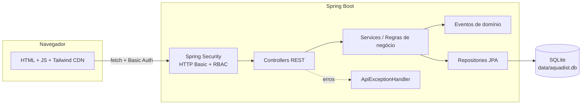
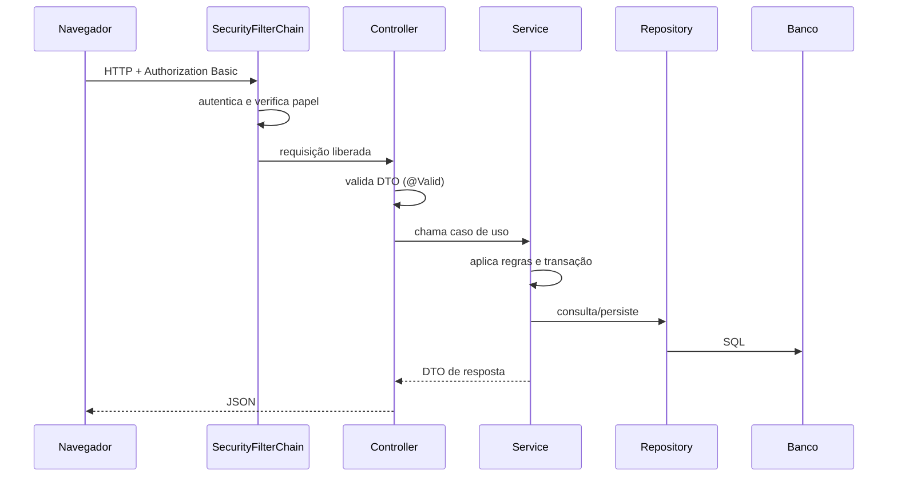
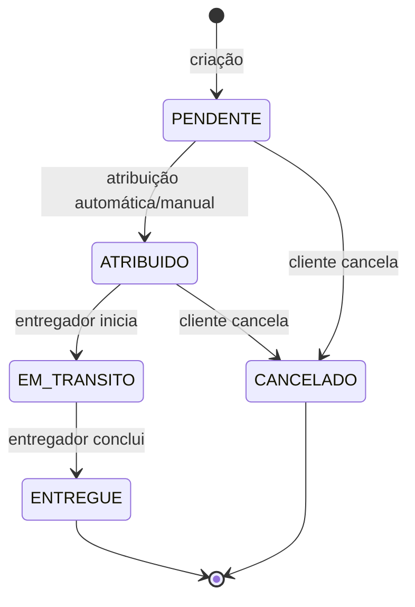

# 04 — Arquitetura

## 1. Visão geral

A aplicação é um monólito Spring Boot organizado em camadas, com API REST e telas estáticas
servidas pelo próprio Tomcat. O banco local é SQLite; os testes usam H2 em memória.



## 2. Camadas

| Camada | Pacote | Responsabilidade |
|---|---|---|
| Apresentação web | `controller` | Contratos HTTP, validação de entrada, autorização por papel |
| Aplicação | `service` | Casos de uso, transações, regras de negócio, orquestração |
| Domínio | `model` | Entidades JPA, enums e comportamentos coesos (caução, validade, status) |
| Persistência | `repository` | Consultas Spring Data JPA |
| Segurança | `security`, `config` | `UserDetailsService`, filtro, RBAC, seed |
| Contratos | `dto` | Requests/responses, validação e mapeamento |
| Eventos | `event` | Publicação e escuta do evento de criação de pedido (cliente ou admin) |
| Erros | `exception` | Exceções de negócio e `ProblemDetail` |
| Interface | `src/main/resources/static` | Páginas HTML, CSS e JavaScript |

## 3. Estrutura de pacotes

```text
com.aquadist
├── AquaDistApplication.java
├── config
│   ├── SecurityConfig.java
│   ├── DataInitializer.java
│   └── SqliteWalVerifier.java
├── controller
│   ├── AuthController.java
│   ├── ClienteController.java
│   ├── ProdutoController.java
│   ├── PedidoController.java
│   ├── EntregadorController.java
│   └── AdminController.java
├── dto
│   ├── ...Requests e Responses (records)
├── event
│   ├── PedidoCriadoEvent.java
│   └── PedidoCriadoListener.java
├── exception
│   ├── ApiExceptionHandler.java
│   └── ...Exceptions
├── model
│   ├── Usuario, Cliente, Entregador, Produto
│   ├── Pedido, ItemPedido, Vasilhame, Pagamento
│   ├── Endereco (embeddable)
│   └── enums...
├── repository
│   └── ...Repositories Spring Data
├── security
│   └── UsuarioDetailsService.java
└── service
    ├── AuthService, ClienteService, EntregadorService
    ├── ProdutoService, EstoqueService
    ├── AtribuicaoEntregadorService
    └── PedidoService
```

## 4. Fluxo de uma requisição



- `spring.jpa.open-in-view=false` evita consultas implícitas na camada web.
- Os services mapeiam entidades para DTOs **dentro da transação**, garantindo que relacionamentos
  `LAZY` sejam acessados com segurança.
- Nenhuma entidade JPA é exposta diretamente na API.

## 5. Máquina de estados do pedido



Regras de transição:

| Origem | Ação | Destino | Validação |
|---|---|---|---|
| `PENDENTE` | Atribuir | `ATRIBUIDO` | Entregador ativo e com capacidade |
| `PENDENTE`/`ATRIBUIDO` | Cancelar | `CANCELADO` | RN04 |
| `ATRIBUIDO` | Iniciar trânsito | `EM_TRANSITO` | Estoque central disponível |
| `EM_TRANSITO` | Concluir | `ENTREGUE` | Vasilhames e estoque consistentes |

O campo `@Version` em `Pedido` adiciona controle de concorrência otimista.

## 6. Atribuição automática por evento

1. `PedidoService.criar` (pedido do cliente) e `PedidoService.criarComoAdmin` (pedido assistido)
   compartilham o método privado `criarPedido`, que salva o pedido e publica `PedidoCriadoEvent`.
2. `PedidoCriadoListener` reage de forma síncrona (`@EventListener`).
3. `AtribuicaoEntregadorService` escolhe o entregador e muda o status.
4. Como o listener executa na mesma transação de criação, o cliente já recebe o status atualizado.
5. Falhas inesperadas na atribuição são registradas em log sem impedir a criação do pedido; o
   administrador pode atribuir manualmente depois.

**Por que evento?** A criação do pedido não precisa conhecer os detalhes de roteirização. O evento
reduz acoplamento e deixa espaço para futuras integrações (notificação, otimização de rota, etc.).

### 6.1 Pagamentos e confirmação

O pagamento é uma preocupação separada do status logístico.

- `Pedido` possui `pagamentoConfirmado` e `pagoEm`.
- `Pagamento` pode estar vinculado a um pedido (`pedidoId`), além do cliente.
- Pedido comum criado pelo cliente nasce **pendente de pagamento**.
- Pedido criado pelo administrador (`POST /api/admin/pedidos`) exige
  `pagamentoConfirmado=true` e forma de pagamento imediata; nasce **pago** e com registro em
  `Pagamento`.
- `POST /api/admin/pedidos/{id}/confirmar-pagamento` confirma um pedido existente não pago,
  exceto `FATURADO`, cancelado ou já pago.
- Na conclusão da entrega, formas diferentes de `FATURADO` confirmam o pagamento e criam o
  registro, se ainda não existir.
- `FATURADO` não confirma pagamento: o valor final vai para o saldo devedor do cliente.
- Pedido já pago não pode ser alterado para `FATURADO` na entrega (HTTP 400).
- O botão **Registrar pagamento** em Clientes é exclusivo para baixar saldo devedor; pagamentos de
  pedidos usam os fluxos acima.

Estados exibidos na administração: **Pago**, **Pendente**, **Faturado** e **—** (cancelado).
A modelagem completa está em [05 — Modelo de dados](05-modelo-de-dados.md) e os fluxos em
[03 — Casos de uso](03-casos-de-uso.md) (UC15 e UC16).

## 7. Segurança

### Autenticação

- HTTP Basic, sem sessão (`SessionCreationPolicy.STATELESS`).
- Senhas com BCrypt.
- `UsuarioDetailsService` carrega o usuário por e-mail e converte o perfil em authority
  `ROLE_ADMIN`, `ROLE_CLIENTE` ou `ROLE_ENTREGADOR`.

### Autorização

- Rotas estáticas (`/`, `/login.html`, `/cliente.html`, `/entregador.html`, `/admin.html`,
  `/assets/**`) são públicas; a proteção dos dados é feita na API.
- `anyRequest().authenticated()` para todo o restante.
- `@PreAuthorize` nos controllers:
  - `hasRole('CLIENTE')`
  - `hasRole('ENTREGADOR')`
  - `hasRole('ADMIN')`
- Regras de propriedade são verificadas nos services:
  - cliente só vê/cancela os próprios pedidos;
  - entregador só opera pedidos atribuídos a ele.
- CSRF desabilitado por ser uma API stateless com Basic; as páginas usam `fetch`.

> **Nota de segurança:** HTTP Basic + credenciais em `sessionStorage` é adequado para demonstração
> local. Em produção, prefira HTTPS obrigatório, JWT/OAuth2, expiração de token e proteção CSRF
> conforme o modelo de autenticação adotado.

### Tratamento de erros

`ApiExceptionHandler` retorna `ProblemDetail` com:

| Exceção | HTTP |
|---|---|
| `RecursoNaoEncontradoException` | 404 |
| `RegraDeNegocioException` | 400 |
| `CreditoExcedidoException` | 422 |
| `EstoqueInsuficienteException` | 409 |
| `OperacaoNaoPermitidaException` | 409 |
| `AcessoNegadoException` / `AccessDeniedException` | 403 |
| `MethodArgumentNotValidException` | 400 + mapa `campos` |
| `HttpMessageNotReadableException` | 400 |
| `DataIntegrityViolationException` | 409 |
| Não tratada | 500 (sem detalhes internos) |

## 8. Persistência

### Produção local — SQLite em modo WAL

```properties
spring.datasource.url=jdbc:sqlite:./data/aquadist.db?journal_mode=WAL&synchronous=NORMAL&busy_timeout=10000&foreign_keys=on
spring.datasource.driver-class-name=org.sqlite.JDBC
spring.jpa.database-platform=org.hibernate.community.dialect.SQLiteDialect
spring.jpa.hibernate.ddl-auto=update
spring.jpa.open-in-view=false
spring.datasource.hikari.maximum-pool-size=5
```

Decisões:

- **Arquivo local** para persistir dados entre reinícios sem instalar servidor.
- **`ddl-auto=update`** cria/atualiza o esquema automaticamente para fins didáticos.
- **WAL (Write-Ahead Logging)** permite que leitores acessem o banco enquanto um escritor
  confirma uma transação. O SQLite continua permitindo **apenas um escritor por vez**.
- **`busy_timeout=10000`** faz uma conexão aguardar até 10 segundos pelo lock de escrita em vez
  de falhar imediatamente com `SQLITE_BUSY`.
- **Pool de 5 conexões** permite atender leituras concorrentes e encurtar a espera de escritas.
- **`synchronous=NORMAL`** é o ajuste recomendado para WAL, equilibrando desempenho e durabilidade.
- **`foreign_keys=on`** ativa a integridade referencial em todas as conexões.
- **`@Version` em `Pedido`** adiciona controle de concorrência otimista no domínio.
- **`SqliteWalVerifier`** registra no startup as pragmas efetivas (`journal_mode`, `synchronous`,
  `busy_timeout`, `foreign_keys`) e o tamanho máximo do pool.
- **Seed idempotente**: `DataInitializer` só executa quando não há usuários.

O modo WAL cria os arquivos `aquadist.db-wal` e `aquadist.db-shm` ao lado do banco. Eles são
gerenciados pelo SQLite e não devem ser apagados com a aplicação em execução.

#### Limites do WAL

WAL resolve a concorrência entre leitura e escrita, mas **não permite múltiplos escritores
simultâneos**. Se duas transações tentarem escrever, uma aguarda o `busy_timeout` ou recebe
`SQLITE_BUSY`. Para um cenário de alta concorrência de escrita, o banco deve migrar para
PostgreSQL ou outro SGBD cliente-servidor.

### Testes — H2 em memória

```properties
spring.datasource.url=jdbc:h2:mem:aquadist_test;DB_CLOSE_DELAY=-1;DB_CLOSE_ON_EXIT=FALSE
spring.datasource.driver-class-name=org.h2.Driver
spring.jpa.database-platform=org.hibernate.dialect.H2Dialect
spring.jpa.hibernate.ddl-auto=create-drop
```

O perfil `test` é ativado com `@ActiveProfiles("test")`. Nenhum teste abre o arquivo SQLite.

### Modelo

Ver [05 — Modelo de dados](05-modelo-de-dados.md).

## 9. Interface web

- HTML estático em `src/main/resources/static`.
- Tailwind CSS via CDN (`https://cdn.tailwindcss.com`), sem build de front-end.
- JavaScript puro, sem framework.
- `assets/js/api.js` centraliza:
  - autenticação Basic;
  - `fetch` e tratamento de erros;
  - formatação de dinheiro/datas;
  - badges de status;
  - toasts;
  - proteção de página por perfil.
- Cada página redireciona o usuário para o painel correto conforme o perfil retornado por
  `GET /api/auth/me`.
- Os painéis de cliente e entregador atualizam os pedidos em segundo plano a cada **30 segundos**
  (polling), além do botão **Atualizar**. Para tempo real por push, a evolução indicada é SSE ou
  WebSocket.
- A área administrativa inclui:
  - modal **+ Novo pedido** para pedido assistido com confirmação obrigatória de pagamento;
  - modal **Confirmar pagamento** para pedidos pendentes;
  - modal de baixa de saldo devedor com histórico;
  - modais de cancelamento e conclusão com validação inline.
- Erros de API em modais são exibidos dentro do próprio modal, no topo, evitando mensagens atrás
  do backdrop.
- As credenciais ficam em `sessionStorage`, são apagadas ao clicar em **Sair** e não persistem
  entre abas/fechamento do navegador.

## 10. Front-end: decisões

| Decisão | Motivo |
|---|---|
| Tailwind via CDN | Atender ao requisito de telas básicas sem pipeline Node |
| Páginas separadas por perfil | Simplicidade e clareza didática |
| `fetch` + JSON | Demonstrar a API real, sem servidor intermediário |
| Sem framework SPA | Reduzir dependências e manter o foco em Spring |
| Basic Auth no `sessionStorage` | Simplicidade para demo local |
| Modais + validação inline | Erros visíveis no contexto da ação, sem `alert/prompt/confirm` nativos |
| Atualização por polling | Simplicidade; evita infraestrutura de push nesta demonstração |

## 11. Build e CI

- Maven Wrapper (`mvnw`, `mvnw.cmd`) com Maven 3.10.1.
- Java 25 (`<java.version>25</java.version>`).
- Suíte com **30 testes** (18 unitários, 6 integração, 6 E2E) executada em H2.
- GitHub Actions em `.github/workflows/ci.yml`:
  - checkout;
  - Temurin 25;
  - cache Maven;
  - `./mvnw -B verify`.

## 12. Decisões e trade-offs

| Decisão | Benefício | Limitação |
|---|---|---|
| Monólito modular | Simples de executar e entender | Não escala horizontalmente sem ajustes |
| SQLite + WAL | Zero instalação, arquivo portátil, leitores concorrentes | Um escritor por vez; não recomendado para alta concorrência |
| HTTP Basic | Implementação rápida e didática | Sem expiração/refresh de token |
| Rastreamento individual de vasilhames | RN05 concreta e auditável | Mais linhas e operações que um contador simples |
| Evento síncrono | Resposta já com status atualizado | Não é processamento assíncrono real |
| Pagamento vinculado ao pedido | Histórico financeiro e confirmação rastreável | Sem estorno automático e sem gateway real |
| Tailwind CDN | Sem build front-end | Dependência de internet e aviso de uso não-produção |
| `ddl-auto=update` | Facilidade local | Em produção usar Flyway/Liquibase |
| DTOs manuais | Sem dependência de mapeadores | Mais código repetitivo |

## 13. Possíveis evoluções arquiteturais

- Flyway para versionamento de esquema.
- JWT com refresh token e endpoint de login.
- `@TransactionalEventListener` + fila para atribuição assíncrona.
- Outbox pattern para eventos.
- Cache de catálogo e disponibilidade.
- Paginação de pedidos e clientes.
- Gateway de pagamento (PIX/cartão) com webhook de confirmação.
- Estorno automático de pagamentos e caução.
- Conciliação financeira e fechamento mensal do limite.
- Testes de contrato e testes de UI com Playwright.
- Observabilidade com Actuator, Micrometer e logs estruturados.
- Empacotamento em container com volume para o SQLite (ou migração para PostgreSQL).
