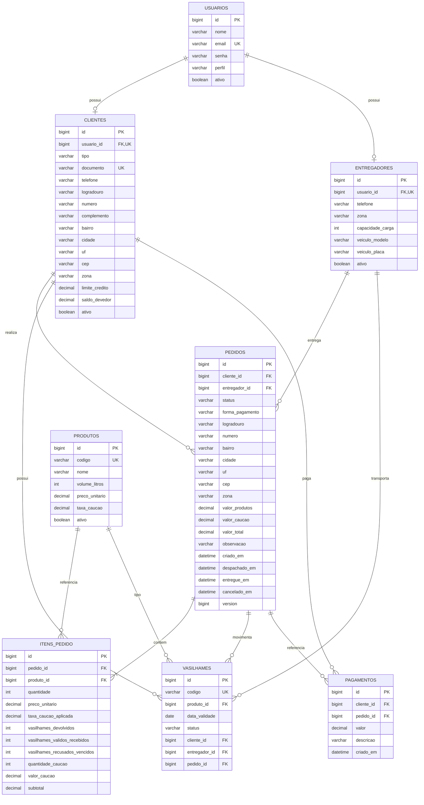
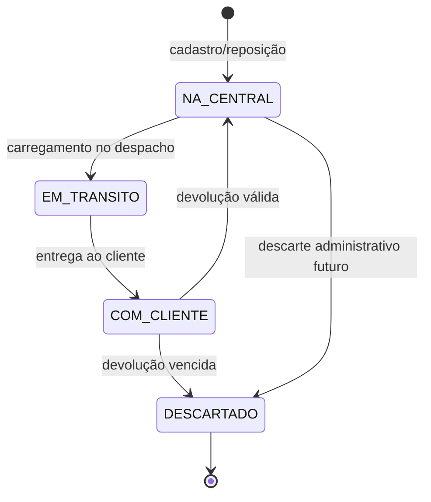

# 05 — Modelo de dados

## 1. Diagrama entidade-relacionamento



O diagrama é conceitual: as relações de `VASILHAMES` com cliente, entregador e pedido são
opcionais e dependem do status atual.

## 2. Entidades

### 2.1 `Usuario`

Identidade de autenticação compartilhada pelos perfis.

| Campo | Tipo | Observação |
|---|---|---|
| `id` | `Long` | PK, auto incremento |
| `nome` | `String(120)` | Nome de exibição |
| `email` | `String(180)` | Único, normalizado em minúsculas |
| `senha` | `String(100)` | Hash BCrypt |
| `perfil` | `PerfilUsuario` | `ADMIN`, `CLIENTE`, `ENTREGADOR` |
| `ativo` | `boolean` | Desabilita login |

### 2.2 `Cliente`

| Campo | Tipo | Observação |
|---|---|---|
| `id` | `Long` | PK |
| `usuario` | `Usuario` | 1:1 obrigatório e único |
| `tipo` | `TipoCliente` | `RESIDENCIAL` ou `CORPORATIVO` |
| `documento` | `String(20)` | CPF/CNPJ, único |
| `telefone` | `String(30)` | Opcional |
| `endereco` | `Endereco` | Embeddable |
| `limiteCredito` | `BigDecimal(12,2)` | Zero para residencial |
| `saldoDevedor` | `BigDecimal(12,2)` | Nunca negativo após pagamento |
| `ativo` | `boolean` | |

Métodos de domínio:

- `permiteCompra(...)` — RN01;
- `getLimiteDisponivel()`;
- `adicionarDebito(...)`;
- `registrarPagamento(...)`.

### 2.3 `Entregador`

| Campo | Tipo | Observação |
|---|---|---|
| `id` | `Long` | PK |
| `usuario` | `Usuario` | 1:1 obrigatório e único |
| `telefone` | `String(30)` | |
| `zona` | `Zona` | Usada na RN03 |
| `capacidadeCarga` | `int` | Total de garrafões no veículo |
| `veiculoModelo` | `String(80)` | |
| `veiculoPlaca` | `String(10)` | |
| `ativo` | `boolean` | |

A carga atual não é um campo persistido: é calculada somando os garrafões de pedidos
`ATRIBUIDO` e `EM_TRANSITO` do entregador.

### 2.4 `Produto`

| Campo | Tipo | Observação |
|---|---|---|
| `id` | `Long` | PK |
| `codigo` | `String(20)` | Único (`G20`, `G10`, `G5`) |
| `nome` | `String(100)` | Ex.: `Garrafao 20L` |
| `volumeLitros` | `int` | |
| `precoUnitario` | `BigDecimal(10,2)` | |
| `taxaCaucao` | `BigDecimal(10,2)` | Por vasilhame faltante |
| `ativo` | `boolean` | |

### 2.5 `Endereco` (embeddable)

Usado em `Cliente` e em `Pedido` (snapshot de entrega).

| Campo | Observação |
|---|---|
| `logradouro`, `numero`, `complemento` | Endereço |
| `bairro`, `cidade`, `uf`, `cep` | Localização |
| `zona` | `NORTE`, `SUL`, `LESTE`, `OESTE`, `CENTRO` |

O pedido copia o endereço no momento da criação para preservar o histórico mesmo que o cadastro
do cliente mude.

### 2.6 `Pedido`

| Campo | Tipo | Observação |
|---|---|---|
| `id` | `Long` | PK |
| `cliente` | `Cliente` | Obrigatório |
| `entregador` | `Entregador` | Nulo até atribuição |
| `status` | `StatusPedido` | Máquina de estados |
| `formaPagamento` | `FormaPagamento` | Forma escolhida/confirmada |
| `pagamentoConfirmado` | `Boolean` | Pagamento recebido (pode ser nulo em registros legados, interpretado como falso) |
| `pagoEm` | `LocalDateTime` | Data/hora da confirmação do pagamento |
| `enderecoEntrega` | `Endereco` | Snapshot |
| `itens` | `List<ItemPedido>` | Cascade all, orphan removal |
| `valorProdutos` | `BigDecimal(12,2)` | |
| `valorCaucao` | `BigDecimal(12,2)` | |
| `valorTotal` | `BigDecimal(12,2)` | |
| `observacao` | `String(500)` | |
| `criadoEm`, `atualizadoEm` | `LocalDateTime` | Preenchidos por callbacks JPA |
| `despachadoEm`, `entregueEm`, `canceladoEm` | `LocalDateTime` | Marcos do fluxo |
| `motivoCancelamento` | `String(500)` | |
| `version` | `Long` | Lock otimista |

Status e significados:

| Status | Significado |
|---|---|
| `PENDENTE` | Criado, ainda sem entregador |
| `ATRIBUIDO` | Entregador definido, estoque ainda na central |
| `EM_TRANSITO` | Vasilhames carregados no veículo |
| `ENTREGUE` | Entrega concluída e estoque conciliado |
| `CANCELADO` | Cancelado antes do despacho |

### 2.7 `ItemPedido`

| Campo | Observação |
|---|---|
| `pedido`, `produto` | Relacionamentos obrigatórios |
| `quantidade` | Garrafões comprados |
| `precoUnitario` | Snapshot do preço |
| `taxaCaucaoAplicada` | Snapshot da caução |
| `vasilhamesDevolvidos` | Declarado na criação |
| `vasilhamesValidosRecebidos` | Conferido na entrega |
| `vasilhamesRecusadosVencidos` | Recusados por validade |
| `quantidadeCaucao` | Garrafões sem troca |
| `valorCaucao` | `quantidadeCaucao × taxa` |
| `subtotal` | `quantidade × precoUnitario` |

### 2.8 `Vasilhame`

| Campo | Observação |
|---|---|
| `codigo` | Único, ex.: `G20-0061` |
| `produto` | Tipo do garrafão |
| `dataValidade` | Verificada na troca (RN05) |
| `status` | `NA_CENTRAL`, `EM_TRANSITO`, `COM_CLIENTE`, `DESCARTADO` |
| `cliente` | Preenchido quando `COM_CLIENTE` |
| `entregador` | Preenchido quando `EM_TRANSITO` |
| `pedido` | Pedido que movimentou o vasilhame |

### 2.9 `Pagamento`

| Campo | Observação |
|---|---|
| `cliente` | Obrigatório |
| `pedido` | Opcional; preenchido quando o pagamento é de um pedido específico |
| `valor` | Maior que zero |
| `descricao` | Texto livre (inclui o número do pedido quando aplicável) |
| `criadoEm` | Data do registro |

Um pagamento pode representar:

- baixa de saldo devedor (sem pedido vinculado);
- pagamento no ato de criação de um pedido pelo administrador;
- pagamento confirmado pelo administrador para um pedido existente;
- pagamento recebido na conclusão da entrega pelo entregador.

### 2.10 Situação de pagamento do pedido

| Situação | Condição | Exibição |
|---|---|---|
| `Pago` | `pagamentoConfirmado = true` | Verde |
| `Pendente` | Forma diferente de `FATURADO` e pagamento ainda não confirmado | Amarelo |
| `Faturado` | Forma `FATURADO`; cobrança ocorre no saldo devedor | Azul |
| `—` | Pedido cancelado | Cinza |

## 3. Enums

| Enum | Valores |
|---|---|
| `PerfilUsuario` | `ADMIN`, `CLIENTE`, `ENTREGADOR` |
| `TipoCliente` | `RESIDENCIAL`, `CORPORATIVO` |
| `Zona` | `NORTE`, `SUL`, `LESTE`, `OESTE`, `CENTRO` |
| `StatusPedido` | `PENDENTE`, `ATRIBUIDO`, `EM_TRANSITO`, `ENTREGUE`, `CANCELADO` |
| `FormaPagamento` | `PIX`, `DINHEIRO`, `CARTAO_CREDITO`, `CARTAO_DEBITO`, `BOLETO`, `FATURADO` |
| `StatusVasilhame` | `NA_CENTRAL`, `EM_TRANSITO`, `COM_CLIENTE`, `DESCARTADO` |

Todos são persistidos como `VARCHAR` (`@Enumerated(EnumType.STRING)`), o que mantém o banco legível.

## 4. Ciclo de vida do vasilhame



Consequências:

- **Estoque central disponível** = vasilhames `NA_CENTRAL` com validade >= hoje.
- **Estoque do veículo** = vasilhames `EM_TRANSITO` agrupados por entregador/produto.
- **Vasilhames com clientes** = `COM_CLIENTE` (válidos e vencidos).
- **Vencidos** = qualquer status não descartado com `dataValidade < hoje`.
- **Descartados** = vasilhames recusados na troca por validade.

## 5. Restrições e índices

| Restrição | Tabela |
|---|---|
| E-mail único | `usuarios.email` |
| Um usuário por cliente | `clientes.usuario_id` unique |
| Um usuário por entregador | `entregadores.usuario_id` unique |
| Documento único | `clientes.documento` |
| Código de produto único | `produtos.codigo` |
| Código de vasilhame único | `vasilhames.codigo` |
| FKs | `pedidos`, `itens_pedido`, `vasilhames`, `pagamentos` |

O Hibernate cria as tabelas em minúsculas (`usuarios`, `clientes`, `pedidos`, ...). O SQLite não
aplica tipagem rígida, mas os tamanhos e precisões declarados documentam a intenção.

## 6. Seed de demonstração

Executado uma única vez por `DataInitializer` quando `usuarios` está vazia.

### Usuários

| Perfil | E-mail | Senha | Observação |
|---|---|---|---|
| `ADMIN` | `admin@aquadist.com` | `admin123` | Acesso total |
| `CLIENTE` | `mercado@aquadist.com` | `cliente123` | Corporativo, limite R$ 2.000, saldo R$ 300 |
| `CLIENTE` | `maria@email.com` | `cliente123` | Residencial, zona SUL |
| `ENTREGADOR` | `joao@aquadist.com` | `entregador123` | Zona CENTRO, capacidade 60 |
| `ENTREGADOR` | `ana@aquadist.com` | `entregador123` | Zona SUL, capacidade 50 |

### Produtos e estoque central

| Código | Produto | Preço | Caução | Estoque central |
|---|---|---|---|---|
| `G20` | Garrafão 20 L | R$ 12,00 | R$ 25,00 | 60 |
| `G10` | Garrafão 10 L | R$ 8,00 | R$ 20,00 | 40 |
| `G5` | Garrafão 5 L | R$ 6,00 | R$ 15,00 | 20 |

### Vasilhames em posse de clientes

| Cliente | Produto | Válidos | Vencidos |
|---|---|---|---|
| Maria | 20 L | 8 | 2 |
| Maria | 10 L | 3 | 0 |
| Mercado | 20 L | 10 | 0 |
| Mercado | 10 L | 0 | 2 |

Códigos determinísticos em uma base recém-criada:

```text
Estoque central G20:  G20-0001 .. G20-0060
Maria válidos G20:    G20-0061 .. G20-0068
Maria vencidos G20:   G20-0069 .. G20-0070
Mercado válidos G20:  G20-0071 .. G20-0080
Estoque central G10:  G10-0001 .. G10-0040
Maria válidos G10:    G10-0041 .. G10-0043
Mercado válidos G10:  G10-0044 .. G10-0053
Mercado vencidos G10: G10-0054 .. G10-0055
Estoque central G5:   G5-0001 .. G5-0020
```

> Se o banco já existir e houver pedidos de testes anteriores, os códigos podem estar em outros
> status. Para uma demonstração limpa, apague `data/aquadist.db*` com a aplicação parada e suba
> novamente.

## 7. Concorrência com WAL

O banco local é aberto com:

```properties
spring.datasource.url=jdbc:sqlite:./data/aquadist.db?journal_mode=WAL&synchronous=NORMAL&busy_timeout=10000&foreign_keys=on
spring.datasource.hikari.maximum-pool-size=5
```

Efeitos:

| Configuração | Efeito |
|---|---|
| `journal_mode=WAL` | Leitores acessam o banco enquanto um escritor grava |
| `synchronous=NORMAL` | Menos sincronizações de disco, adequado ao modo WAL |
| `busy_timeout=10000` | Espera até 10 s por um lock de escrita antes de falhar |
| `foreign_keys=on` | Integridade referencial por conexão |
| Pool de 5 conexões | Atende leituras concorrentes e transações curtas |
| `@Version` em `Pedido` | Detecta atualizações concorrentes no domínio |

Limitações:

- O SQLite continua com **um único escritor por vez**.
- Escritas concorrentes podem aguardar até o `busy_timeout` e, em seguida, retornar `SQLITE_BUSY`.
- Transações longas devem ser evitadas; o projeto mantém `open-in-view=false` e transações curtas.
- Para alta concorrência de escrita, usar PostgreSQL.

O modo WAL cria `data/aquadist.db-wal` e `data/aquadist.db-shm`. Esses arquivos são ignorados pelo
Git e não devem ser removidos com a aplicação em execução.

`SqliteWalVerifier` registra no startup as pragmas efetivas para confirmar a configuração.

## 8. Reset do banco

```powershell
# Windows PowerShell, com a aplicação parada
Remove-Item .\data\aquadist.db* -Force -ErrorAction SilentlyContinue
.\mvnw.cmd spring-boot:run
```

```bash
# Linux/macOS, com a aplicação parada
rm -f data/aquadist.db data/aquadist.db-wal data/aquadist.db-shm
./mvnw spring-boot:run
```

O diretório `data` contém um `.gitkeep` para existir no clone. O arquivo `.db` e os arquivos WAL
estão no `.gitignore`.
