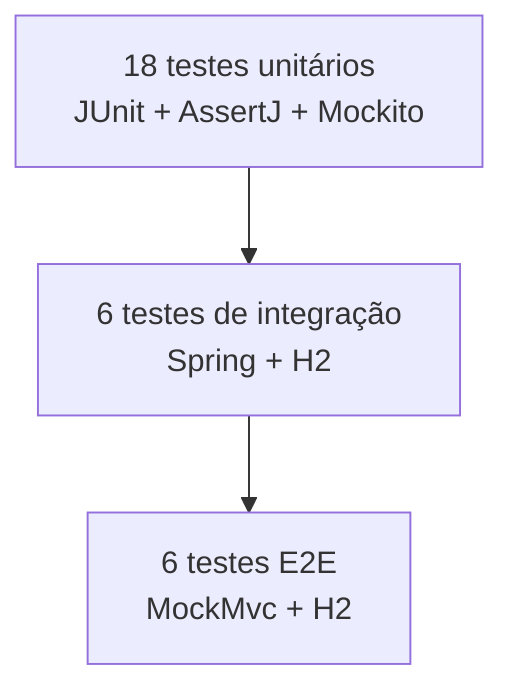

# 07 — Testes

## 1. Estratégia

A suíte segue uma pirâmide com três níveis:



| Nível | Quantidade | Banco | Tempo típico |
|---|---|---|---|
| Unitário | 18 | Nenhum | milissegundos |
| Integração | 6 | H2 em memória | ~0,1 s |
| E2E | 6 | H2 em memória | ~6 s |
| **Total** | **30** | — | **~10 s** |

## 2. Banco de testes

Os testes usam o perfil `test`:

`src/test/resources/application-test.properties`

```properties
spring.datasource.url=jdbc:h2:mem:aquadist_test;DB_CLOSE_DELAY=-1;DB_CLOSE_ON_EXIT=FALSE
spring.datasource.driver-class-name=org.h2.Driver
spring.datasource.username=sa
spring.datasource.hikari.maximum-pool-size=5
spring.jpa.database-platform=org.hibernate.dialect.H2Dialect
spring.jpa.hibernate.ddl-auto=create-drop
```

Propriedades:

- **H2 em memória**: nenhum arquivo é criado e o banco desaparece ao encerrar a JVM.
- **`create-drop`**: esquema limpo para cada contexto de teste.
- **Perfil ativado** com `@ActiveProfiles("test")`.
- **SQLite não é aberto durante os testes**.
- O `DataInitializer` popula o H2 com o mesmo seed de demonstração.

O isolamento entre testes de integração/E2E é garantido por `@Transactional` na classe de teste:
as alterações são revertidas ao final de cada método.

## 3. Testes unitários (18)

### 3.1 `PedidoCalculoTest` — 5 testes

Arquivo: `src/test/java/com/aquadist/unit/PedidoCalculoTest.java`

| Teste | Cobre |
|---|---|
| Calcula caução por vasilhames faltantes | RN02 |
| Zera a caução quando todos os vasilhames são devolvidos | RN02 |
| Recalcula a caução após a conferência | RN02 |
| Soma produtos e cauções de itens distintos | RN02 |
| Status permitem cancelamento até `ATRIBUIDO` | RN04 |

### 3.2 `ClienteCreditoTest` — 5 testes

Arquivo: `src/test/java/com/aquadist/unit/ClienteCreditoTest.java`

| Teste | Cobre |
|---|---|
| Permite compra dentro do limite | RN01 |
| Bloqueia compra acima do limite | RN01 |
| Cliente residencial não possui bloqueio | RN01 |
| Calcula limite disponível sem ficar negativo | RN01 |
| Pagamento reduz saldo devedor e nunca fica negativo | RN01 / UC05 |

### 3.3 `VasilhameValidadeTest` — 3 testes

Arquivo: `src/test/java/com/aquadist/unit/VasilhameValidadeTest.java`

| Teste | Cobre |
|---|---|
| Identifica vasilhame vencido | RN05 |
| Apenas vasilhame válido em posse do cliente pode ser trocado | RN05 |
| Transições de estoque atualizam status e vínculos | RN05 / UC02 |

### 3.4 `AtribuicaoEntregadorTest` — 5 testes

Arquivo: `src/test/java/com/aquadist/unit/AtribuicaoEntregadorTest.java`

| Teste | Cobre |
|---|---|
| Prioriza entregador da mesma zona | RN03 |
| Usa outra zona quando a da zona não tem capacidade | RN03 |
| Não atribui quando todos estão com carga cheia | RN03 |
| Capacidade considera a carga atual | RN03 |
| Atribuição altera o pedido para `ATRIBUIDO` | RN03 |

Os repositórios são simulados com **Mockito**, sem Spring.

## 4. Testes de integração (6)

### `PedidoServiceIntegrationTest`

Arquivo: `src/test/java/com/aquadist/integration/PedidoServiceIntegrationTest.java`

`@SpringBootTest` + `@ActiveProfiles("test")` + `@Transactional`.
Exercita os services reais com repositórios JPA e H2.

| Teste | Cobre |
|---|---|
| Calcula caução e atribui entregador da zona | RN02 + RN03 |
| Bloqueia pedido acima do limite | RN01 |
| Permite cancelar antes e bloqueia depois do despacho | RN04 |
| Recusa vasilhame vencido, cobra caução e atualiza estoque | RN05 |
| Admin cria pedido com pagamento confirmado | UC15 / RP01, RP02 |
| Admin confirma pagamento de pedido existente | UC16 / RP03 |

O teste de RN05 verifica:

- status final `ENTREGUE`;
- 1 vasilhame válido recebido e 1 recusado;
- caução ajustada de R$ 50,00 para R$ 25,00;
- total final de R$ 49,00;
- vasilhame vencido com status `DESCARTADO`;
- vasilhame válido retornando para `NA_CENTRAL`.

## 5. Testes E2E (6)

### 5.1 `FluxoPedidoE2ETest` — 1 teste

Arquivo: `src/test/java/com/aquadist/e2e/FluxoPedidoE2ETest.java`

Executa o fluxo HTTP completo com `MockMvc`, passando por:

1. filtros de segurança;
2. autenticação Basic;
3. controllers;
4. validação de DTOs;
5. services e regras de negócio;
6. JPA/H2;
7. serialização JSON.

Passos:

1. `GET /api/auth/me` como Maria → perfil `CLIENTE`.
2. `POST /api/pedidos` com 4 garrafões e 2 devoluções → `201`, status `ATRIBUIDO`,
   caução `50`, total `98`, entregador Ana Souza.
3. `GET /api/entregador/pedidos` como Ana → pedido na rota.
4. `POST /api/entregador/pedidos/{id}/iniciar-transito` → `200`, `EM_TRANSITO`.
5. `POST /api/pedidos/{id}/cancelar` como Maria → `409` (RN04).
6. `GET /api/entregador/pedidos/{id}/vasilhames-cliente` → lista de vasilhames.
7. `POST /api/entregador/pedidos/{id}/concluir` com 2 códigos válidos → `200`, `ENTREGUE`.
8. `GET /api/pedidos/me` → pedido entregue.

### 5.2 `SegurancaE2ETest` — 5 testes

Arquivo: `src/test/java/com/aquadist/e2e/SegurancaE2ETest.java`

| Teste | Verificação |
|---|---|
| API sem credenciais | 401 com JSON de erro |
| Credenciais inválidas | 401 |
| Cliente/entregador em endpoints de admin | 403 |
| Páginas e assets públicos | 200 e conteúdo esperado |
| Admin acessa painel | 200 em `/api/auth/me` e `/api/admin/pedidos` |

As páginas verificadas são `login.html`, `cliente.html`, `entregador.html`, `admin.html`,
`index.html` e `assets/js/api.js`.

### Sobre "E2E"

Os testes E2E são de **HTTP/backend**: percorrem toda a pilha Spring e o banco em memória, mas não
abrem um navegador real. A interface é estática e foi validada por:

- testes que garantem que as páginas são servidas;
- verificação de sintaxe dos scripts JavaScript com Node.js (`new Function`);
- roteiro manual descrito em [08 — Manual de uso](08-manual-de-uso.md).

Para automação real de navegador, a evolução natural é adicionar Playwright ou Selenium.

## 6. Como executar

### Todos os testes

```powershell
.\mvnw.cmd test
```

```bash
./mvnw test
```

### Build completo (compila + testa + empacota)

```powershell
.\mvnw.cmd -B verify
```

```bash
./mvnw -B verify
```

### Uma classe específica

```powershell
.\mvnw.cmd -Dtest=PedidoServiceIntegrationTest test
```

```powershell
.\mvnw.cmd -Dtest=FluxoPedidoE2ETest test
```

### Um método específico

```powershell
.\mvnw.cmd "-Dtest=FluxoPedidoE2ETest#fluxoCompletoDePedido" test
```

### Relatórios

Os relatórios HTML e XML ficam em:

```text
target/surefire-reports/
```

Abra `target/surefire-reports/index.html` ou os arquivos `.txt` por classe.

## 7. Rastreabilidade regra → teste

| Regra | Unitários | Integração | E2E |
|---|---|---|---|
| RN01 | `ClienteCreditoTest` | `bloqueiaPedidoAcimaDoLimite` | admin/cliente auth |
| RN02 | `PedidoCalculoTest` | `calculaCaucaoEAtribuiEntregadorDaZona` | `FluxoPedidoE2ETest` |
| RN03 | `AtribuicaoEntregadorTest` | `calculaCaucaoEAtribuiEntregadorDaZona` | `FluxoPedidoE2ETest` |
| RN04 | `PedidoCalculoTest` | `bloqueiaCancelamentoDepoisDoDespacho` | `FluxoPedidoE2ETest` |
| RN05 | `VasilhameValidadeTest` | `recusaVasilhameVencidoNaTroca` | `FluxoPedidoE2ETest` |
| Pagamento (UC15/UC16) | — | `adminCriaPedidoComPagamentoConfirmado`, `adminConfirmaPagamentoDePedidoExistente` | — |
| RBAC | — | — | `SegurancaE2ETest` |

## 8. Dados e isolamento

- O seed é criado uma vez por contexto Spring.
- Testes de integração/E2E usam `@Transactional`; cada teste executa em uma transação revertida.
- Testes unitários não compartilham estado.
- Os testes não dependem da ordem de execução.
- A base H2 usa nome fixo com `DB_CLOSE_DELAY=-1` para o contexto reaproveitado.
- O SQLite de desenvolvimento não é alterado.

## 9. Integração contínua

Workflow: `.github/workflows/ci.yml`

```yaml
name: CI
on: [push, pull_request]
jobs:
  build:
    runs-on: ubuntu-latest
    steps:
      - uses: actions/checkout@v4
      - uses: actions/setup-java@v4
        with:
          distribution: temurin
          java-version: '25'
          cache: maven
      - run: chmod +x mvnw
      - run: ./mvnw -B verify
```

O pipeline executa os 30 testes com H2 em memória e gera o JAR da aplicação.

## 10. Limitações e próximos passos

- Adicionar testes de mutação (PIT) para avaliar a qualidade dos testes.
- Adicionar cobertura com JaCoCo e meta mínima.
- Adicionar testes de contrato (Spring Cloud Contract ou OpenAPI).
- Adicionar Playwright para testar as telas e o fluxo de autenticação no navegador.
- Testar concorrência real de pedidos e atribuição (o SQLite de produção local tem um escritor,
  mas a lógica usa `@Version`).
